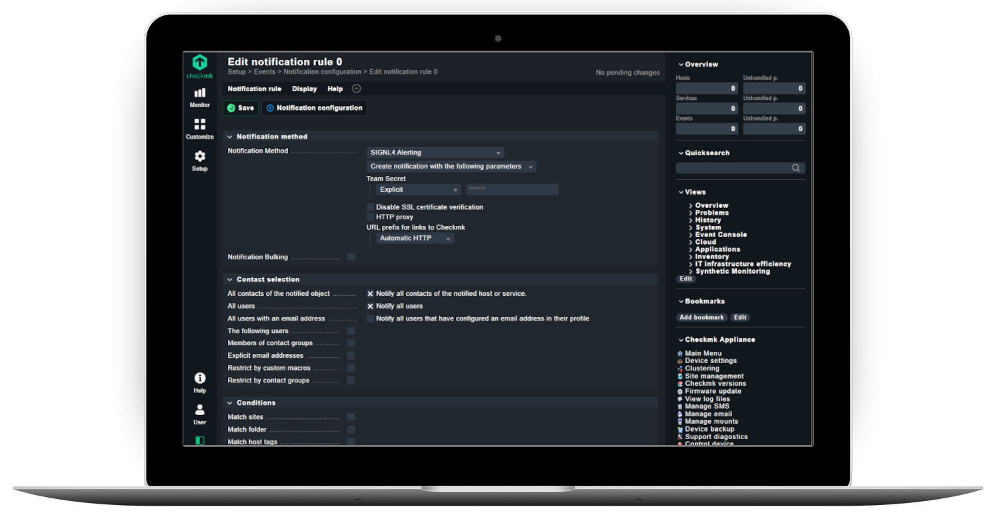
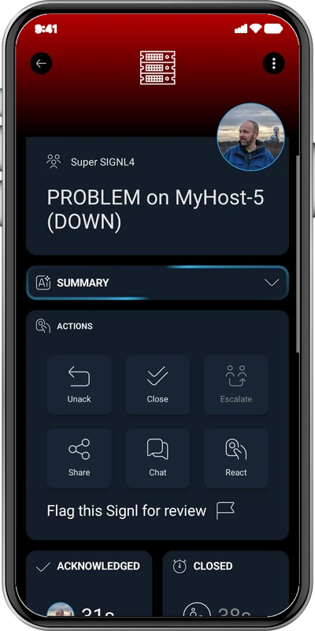

# SIGNL4 Integration with Checkmk

When a production database stops responding overnight, [Checkmk](https://checkmk.com/) detects the service failure and sends a notification to SIGNL4. SIGNL4 uses the on-call schedule to reach the engineer on duty via mobile push, SMS or voice call. If the alert goes unacknowledged, SIGNL4 follows the team's escalation policy.

Use the built-in **SIGNL4 Alerting** notification method in Checkmk 2.0 or later to send problem and recovery notifications. Add the optional back channel to acknowledge Checkmk problems and send comments from the SIGNL4 mobile app.

## Send Checkmk notifications to SIGNL4

1. In the SIGNL4 web portal, go to **Teams** and copy the **Secret** for the team that should receive Checkmk notifications. The secret is the last segment of the team's **Webhook (Inbound)** URL.
2. In Checkmk, create a parameter set under **Setup → Events → Notifications → Parameters for notification methods → Parameters for SIGNL4 Alerting**. In **Team Secret**, enter the secret or select it from the Checkmk password store.
3. Create a notification rule, select **SIGNL4 Alerting** as the notification method and assign the parameter set. On versions that expose **Team Secret** directly in the rule, enter it there.
4. Set the rule conditions to match the hosts and services you want to alert on. Include the corresponding recovery events so Checkmk can close the matching SIGNL4 alert when the host returns to **UP** or the service returns to **OK**.
5. Save the rule, activate the changes and test with a host or service covered by the rule. Confirm that a problem opens a SIGNL4 alert and that the recovery closes it.

For version-specific settings and testing options, see [Checkmk's SIGNL4 notification documentation](https://docs.checkmk.com/latest/en/notifications_signl4.html) and the [Checkmk guide to notifications](https://docs.checkmk.com/latest/en/notifications.html).

### Example alert in SIGNL4

The alert in the SIGN4 mobile app might look like this.

## Two-Way Integration

The SIGNL4 back channel sends updates to the Checkmk REST API. For an on-premises Checkmk site, make the API reachable from SIGNL4 over HTTPS. See [back-channel connectivity options](https://docs.signl4.com/samples/back-channel-connectivity/).

1. In the SIGNL4 web portal, open **Integrations → Gallery**, search for **Checkmk** and select the **Checkmk ITOM** entry for two-way updates.
2. In **Checkmk URL**, enter the REST API base URL for your site, such as `https://checkmk.example.com/mysite/check_mk/api/v1/`.
3. Enter the Checkmk username and password for an account with the REST API permissions required to update the monitored hosts and services. For a Checkmk automation user, enter its automation secret in the password field.
4. Enable **Annotations as Ack** if you want mobile annotations to appear as comments in Checkmk and acknowledge the associated problem.
5. Select **Install** and verify that the connector status shows `Everything is fine.` Trigger a test problem, acknowledge it in the SIGNL4 mobile app and verify the acknowledgement in Checkmk.

Closing an alert in the SIGNL4 app adds a comment to the affected host or service in Checkmk. The monitored host or service state continues to reflect the results of Checkmk's checks.

### Video walkthrough

The video shows how to set up the integration in Checkmk 2.x.

<iframe width="560" height="315" src="https://www.youtube-nocookie.com/embed/4-HtakTR4SI?si=bxdbBf-40VLUF5Bi" title="YouTube video player" frameborder="0" allow="accelerometer; autoplay; clipboard-write; encrypted-media; gyroscope; picture-in-picture; web-share" referrerpolicy="strict-origin-when-cross-origin" allowfullscreen></iframe>

## Older Versions of Checkmk

For releases before Checkmk 2.0, see the [legacy SIGNL4 package and installation instructions on GitHub](https://github.com/signl4/signl4-integration-checkmk). The [SIGNL4 listing on Checkmk Exchange](https://exchange.checkmk.com/p/signl4) lists the minimum Checkmk version for each available package release.
