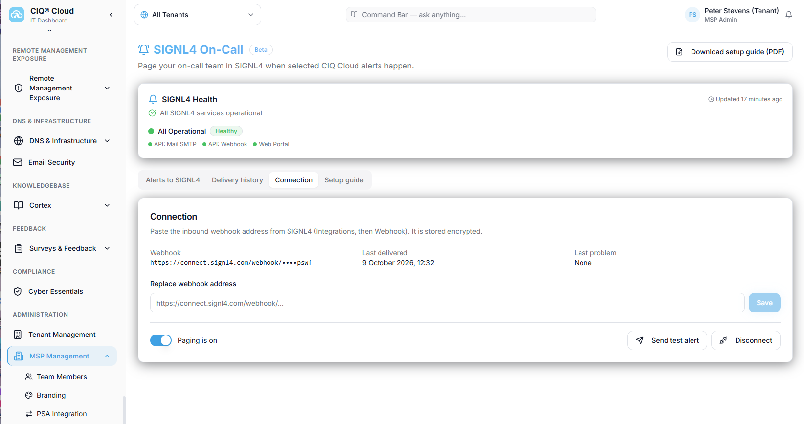
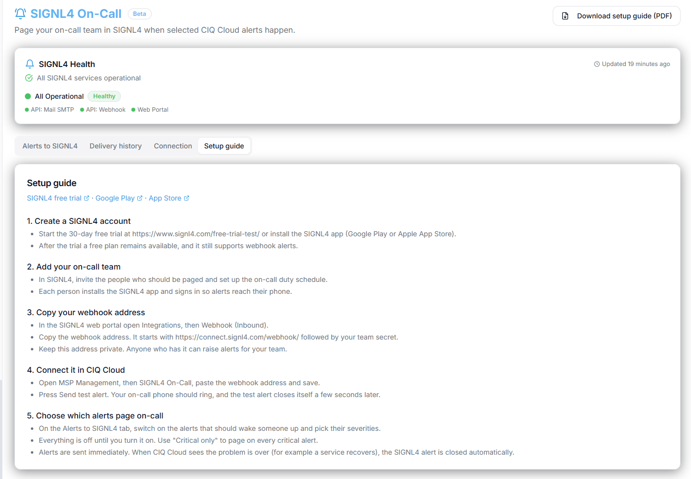
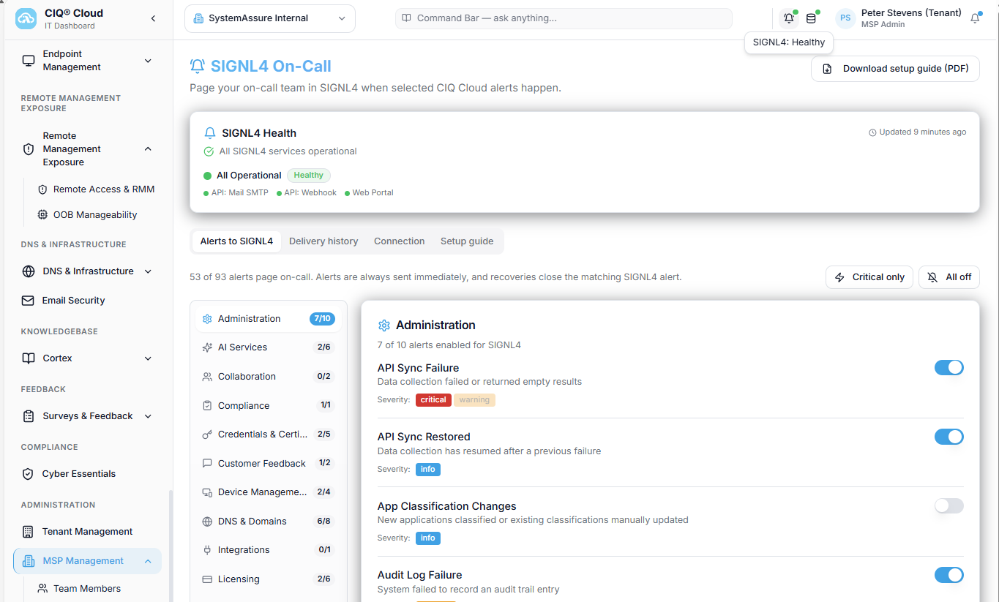
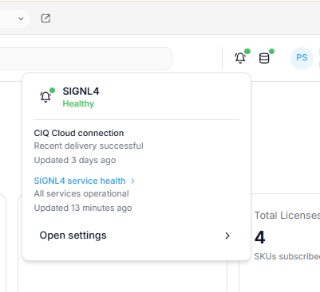
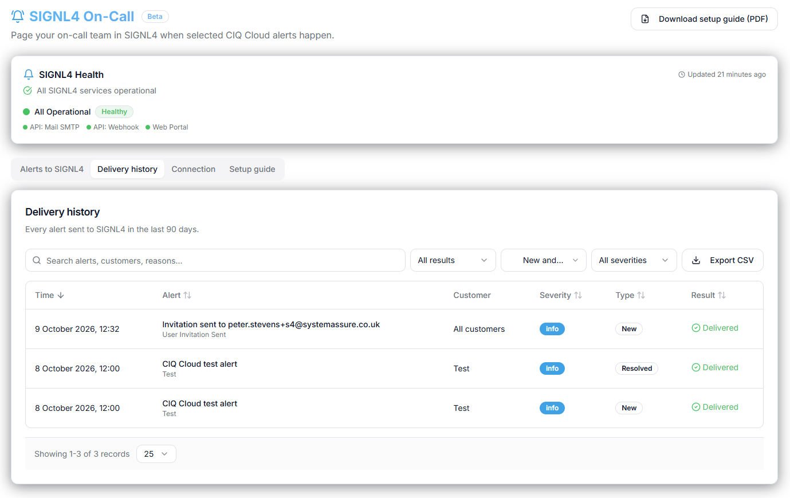

# SIGNL4 Integration with CIQ Cloud

[CIQ Cloud](https://ciqcloud.ai/) provides operational visibility for managed service providers (MSPs) and enterprise IT organizations. Its **SIGNL4 On-Call** integration forwards selected CIQ Cloud alerts to SIGNL4 for reliable mobile notification and response.

SIGNL4 notifies the responsible on-call people through mobile app push, SMS and voice calls, with acknowledgement, automated escalation and on-call scheduling. Teams can respond to important CIQ Cloud events even when they are away from their dashboards.

Common use cases include:

* critical infrastructure and service alerts for MSP operations
* after-hours notification of the technician on call
* escalation of important customer or tenant incidents
* notification of security or compliance-related events
* mobile response to critical CIQ Cloud alerts

## Prerequisites

* A [SIGNL4](https://www.signl4.com/) account and team
* Access to CIQ Cloud with permission to configure the MSP-level SIGNL4 integration
* The webhook address for your SIGNL4 team

## How to Integrate

CIQ Cloud includes a **SIGNL4 On-Call** integration. Setup primarily requires adding your SIGNL4 webhook address; CIQ Cloud then lets you choose which alerts should be forwarded.

### 1. Get Your SIGNL4 Webhook Address

In SIGNL4, use your team's webhook endpoint. The address follows this pattern:

```text
https://connect.signl4.com/webhook/YOUR_SIGNL4_SECRET
```

Replace `YOUR_SIGNL4_SECRET` with your actual SIGNL4 team secret. Keep this address private, as it allows alerts to be sent to your team.

### 2. Configure the Connection in CIQ Cloud

1. In CIQ Cloud, open **MSP Management** and select **SIGNL4 On-Call**.
2. Go to the **Connection** tab.
3. Paste the webhook URL into the webhook address field and save your settings.
4. Use **Send test alert** to check the connection.



CIQ Cloud also provides a built-in **Setup guide** with instructions for creating a SIGNL4 account, adding team members, copying the webhook address, and connecting the services.



### 3. Select Which Alerts to Forward

Open the **Alerts to SIGNL4** tab under **SIGNL4 On-Call**.

At the MSP level, select the CIQ Cloud alert types that should trigger SIGNL4 notifications. The configuration screen shows alert categories and individual alert types, so you can enable the relevant events instead of forwarding everything.



### 4. Check SIGNL4 Health

CIQ Cloud shows a **SIGNL4 status icon** in its top bar. The status panel provides information about the SIGNL4 service status, connection health and whether an agent is on call.



### 5. Review Delivery History

Open the **Delivery history** tab in the SIGNL4 On-Call integration to see previously sent notifications and their delivery results. CIQ Cloud records this history so MSPs can verify that notifications were delivered.



## Example

A monitored customer service or application raises a critical event in CIQ Cloud. If its alert type is enabled for SIGNL4, the event is forwarded to the connected SIGNL4 team:

```text
CIQ Cloud detects an important event
    |
    v
Configured CIQ Cloud alert type
    |
    v
SIGNL4 webhook
    |
    v
On-call team receives a mobile alert
    |
    +--> App push notification
    +--> SMS or voice call
    +--> Acknowledgement and escalation
```

With SIGNL4, the on-call technician can acknowledge the alert on their phone, while escalation helps ensure the notification is not overlooked.

An example SIGNL4 alert looks like this (illustrative screenshot):


That's it. CIQ Cloud events can now reach the responsible team through SIGNL4, with mobile alerting, on-call routing and automated escalation.

For additional SIGNL4 webhook details, see the [SIGNL4 webhook integration](https://docs.signl4.com/integrations/webhook/).
