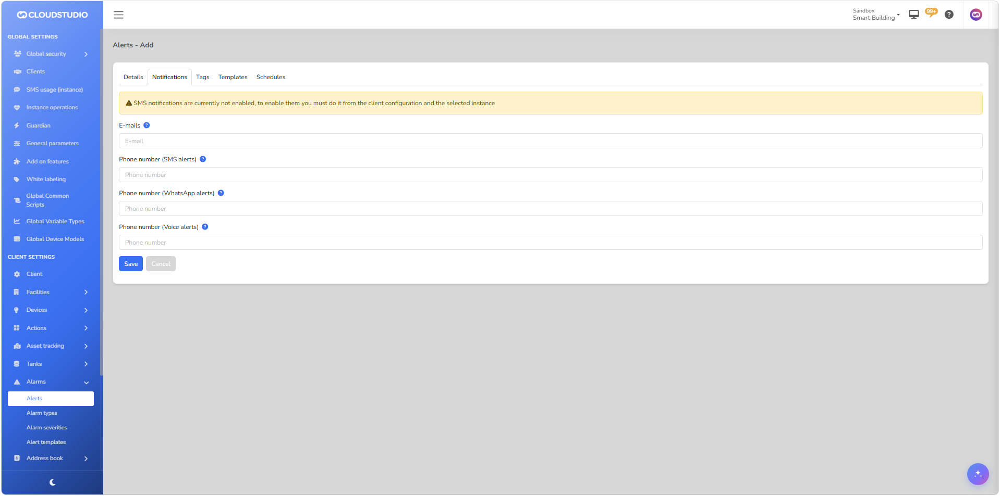

# SIGNL4 Integration with Cloud Studio IoT

[Cloud Studio IoT](https://cloudstudioiot.com/iot-platform) is a low-code, multi-tenant IoT platform for connecting and monitoring LoRaWAN, MQTT, and industrial devices. System integrators can use it to build dashboards, configure alarms, and deliver white-label IoT solutions to their customers.

A critical alarm on an IoT dashboard is only useful if somebody sees it. By integrating Cloud Studio IoT with [SIGNL4](https://www.signl4.com/), you can notify the people currently on duty through mobile app push notifications, SMS, and voice calls. SIGNL4 adds acknowledgement, on-call scheduling, and automated escalation when nobody responds.

Typical use cases include:

* Alerting on-call technicians when a pumping station reports abnormal pressure or water levels.
* Escalating temperature excursions detected by LoRaWAN sensors in cold rooms or industrial equipment.
* Notifying facility teams about critical energy, environmental, or building-monitoring thresholds.
* Routing alarms from distributed industrial sites to the responsible field service team, even outside business hours.

The integration uses **Cloud Studio IoT email notifications** and the **SIGNL4 email interface**. No additional software, scripts, or webhooks are required.

## Prerequisites

* A [Cloud Studio IoT](https://cloudstudioiot.com/) account with permission to create or edit alerts.
* A [SIGNL4](https://www.signl4.com/) account with a team configured to receive alerts.
* The team's dedicated SIGNL4 email address, in the format `{teamsecret}@mail.signl4.com`, where `{teamsecret}` is the team's secret.

## How to Integrate

Cloud Studio IoT can send an email when an alert condition produces an alarm. SIGNL4 receives that email and notifies the team members on duty.



```text
IoT device / sensor (LoRaWAN, MQTT, industrial)
                      |
                      v
               Cloud Studio IoT
               Alert condition
                      |
                      v
              Email notification
                      |
                      v
            SIGNL4 team email address
                      |
                      v
                    SIGNL4
                      |
        +-------------+-------------+
        |             |             |
       Push          SMS          Voice
                      |
                      v
          On-call routing / escalation
                      |
                      v
             Mobile acknowledgement
```

### 1. Get Your SIGNL4 Team Email Address

1. Sign in to [SIGNL4](https://account.signl4.com/) and select the team that should receive the Cloud Studio IoT alarms.
2. Find the team's dedicated inbound email address. It has the following format:

   ```text
   {teamsecret}@mail.signl4.com
   ```

3. Copy the address for use in Cloud Studio IoT.

For details, see the [SIGNL4 email integration](https://docs.signl4.com/integrations/email/). Treat the team address as sensitive because anyone who knows it may be able to send alerts to your team.

### 2. Configure an Alert in Cloud Studio IoT

1. Sign in to Cloud Studio IoT and navigate to **Client Configuration > Alarms > Alerts**.
2. Create an alert or open an existing one using the **three dots** on the right and select **Edit**.
3. Configure the alert condition for the relevant device endpoint. Specify the threshold and, if needed, how long the condition must persist before an alarm is raised.
4. Find the **Notifications** section. In **E-mails**, enter your SIGNL4 team address (for example, `{teamsecret}@mail.signl4.com`).
5. **Press Enter** after typing the address. Make sure it appears as a highlighted box; otherwise, Cloud Studio IoT may not save the recipient. The address does not have to exist in the Cloud Studio IoT address book.
6. Optionally, customize the notification subject using the variables available in your Cloud Studio IoT instance. SIGNL4 uses the email subject as the alert title and the email body as the alert text.
7. **Save** the alert.

For example, you could use the following subject to identify the affected device and facility:

```text
Cloud Studio IoT: {DEVICE_OR_ENDPOINT_NAME} at {FACILITY_NAME}
```

Other documented subject variables include `{CLIENT_NAME}`, `{DEVICE_NAME}`, `{ENDPOINT_NAME}`, `{ALARM_TEXT}`, and `{ALARM_DETAILS}`. The available variables depend on your instance and notification configuration. See [Cloud Studio IoT's alert notification variables](https://cloudstudioiot.com/docs/configuracion-del-cliente/alertas-y-alarmas/variables-para-notificaciones-de-alertas).

> **Note:** This is a one-way email integration. Acknowledging or closing an alert in SIGNL4 does not automatically acknowledge or close the original alarm in Cloud Studio IoT. If Cloud Studio IoT also sends separate emails when alarms close, those emails are not automatically correlated with the original SIGNL4 alert in this basic setup.

### 3. Test the Integration

1. Use a test device or a controlled alert condition to generate an alarm in Cloud Studio IoT.
2. Verify that Cloud Studio IoT sends an email notification to the configured SIGNL4 team address.
3. Confirm that the alert appears in the SIGNL4 mobile app with the expected title and message.
4. Check that the appropriate on-call team member is notified and can acknowledge the alert.
5. If needed, review your SIGNL4 team's escalation and duty schedule settings.

That's it. New Cloud Studio IoT alarms can now reach the people responsible for responding, without requiring them to watch a dashboard continuously.

## Example

A LoRaWAN water-level sensor at a remote pumping station reports a reading below the configured threshold. Cloud Studio IoT raises an alarm and sends an email to the SIGNL4 team address.

SIGNL4 notifies the technician currently on duty via mobile push and, depending on the team's configuration, SMS or voice calls. If there is no response, SIGNL4 can escalate the alert to another team member. The technician acknowledges the alert in SIGNL4 and investigates the issue in Cloud Studio IoT.


*Illustrative SIGNL4 IoT alert. The actual title and details depend on the notification email configured in Cloud Studio IoT.*

## Troubleshooting

* **No alert in SIGNL4:** Confirm that the Cloud Studio IoT alarm actually triggered, the team email address is correct, and the recipient was saved by pressing **Enter**.
* **Title or details are missing:** Check the Cloud Studio IoT email subject, body, and notification variables. SIGNL4 uses the subject as the title and the body as the alert text.
* **The wrong person is notified:** Review the SIGNL4 team membership, duty schedule, and escalation settings.
* **An alarm closes in Cloud Studio IoT but remains open in SIGNL4:** The email-based configuration does not provide automatic status synchronization. Close the SIGNL4 alert separately.

## References

* [Cloud Studio IoT](https://cloudstudioiot.com/)
* [Cloud Studio IoT Platform](https://cloudstudioiot.com/iot-platform)
* [Cloud Studio IoT: Alerts](https://cloudstudioiot.com/docs/configuracion-del-cliente/alertas-y-alarmas/alertas)
* [Cloud Studio IoT: Configuring Contacts for Notifications](https://cloudstudioiot.com/docs/configuracion-del-cliente/alertas-y-alarmas/configuracion-contactos-para-notificaciones)
* [Cloud Studio IoT: Variables for Alert Notifications](https://cloudstudioiot.com/docs/configuracion-del-cliente/alertas-y-alarmas/variables-para-notificaciones-de-alertas)
* [SIGNL4 Email Integration](https://docs.signl4.com/integrations/email/)

With Cloud Studio IoT and SIGNL4, important IoT alarms can reach the right on-call person through reliable mobile alerting and automated escalation.
