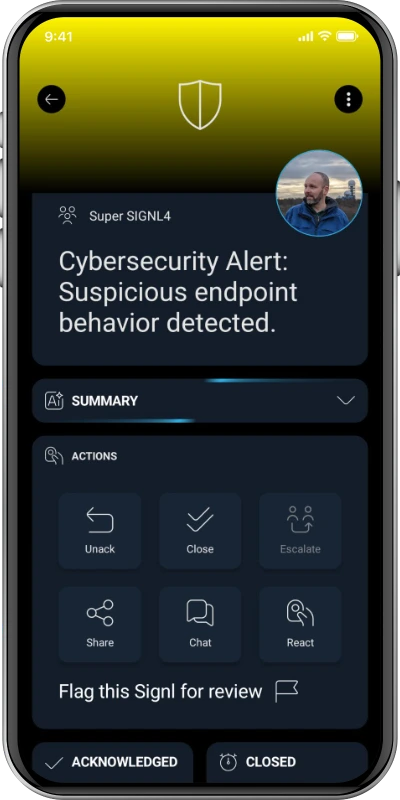

# SIGNL4 Integration with Cluster Reply

[Cluster Reply](https://www.reply.com/cluster-reply-germany/en/) is a Microsoft-focused consulting and systems integration company in the Reply Group. It helps organizations design, implement and operate solutions based on Microsoft technologies, including Azure cloud infrastructure, applications and security.

SIGNL4 adds reliable mobile alerting and incident response to Azure-based solutions: app push, SMS, voice calls, on-call scheduling, acknowledgements and automated escalation. Critical cloud or security incidents can reach the engineer who is currently responsible, wherever they are.

This guide presents a **proposed integration pattern for Azure environments implemented or managed by Cluster Reply**. It is **not** an announcement of a native Cluster Reply product integration or a verified Cluster Reply partnership.

Typical use cases:

* Azure service availability and health incidents
* Application failures and performance threshold breaches
* Failed jobs, integration workflows or cloud automations
* Security incidents detected by Microsoft Sentinel
* After-hours escalation to on-call cloud or SOC engineers

## Prerequisites

* A [SIGNL4](https://www.signl4.com/) account and team or integration secret
* Access to a Microsoft Azure subscription with appropriate permissions
* An Azure Monitor alert rule and action group (for the Azure Monitor example)
* For the customized integration: an Azure Logic App with an HTTP trigger and HTTP action
* Network access to `https://connect.signl4.com` from the sending Azure service

## How to Integrate

The recommended pattern uses **Azure Monitor → Action Group → Azure Logic Apps → SIGNL4**. Logic Apps can filter incidents and transform Microsoft's alert schema into a concise mobile alert. For a simple setup, an Azure Monitor action group can also POST directly to the SIGNL4 webhook, though the payload will be less tailored.

### 1. Create the SIGNL4 Webhook

In SIGNL4, create or use a webhook integration. Its URL has this format:

```text
https://connect.signl4.com/webhook/YOUR_SIGNL4_SECRET
```

Replace `YOUR_SIGNL4_SECRET` with your actual SIGNL4 team or integration secret. Treat this URL like a credential. Avoid putting it in public repositories or diagnostics logs.

See [SIGNL4 Webhook documentation](https://docs.signl4.com/integrations/webhook/).

### 2. Create an Azure Logic App

In the Azure portal, create a **Logic App (Consumption)** and open its designer.

1. Add the trigger **When an HTTP request is received**.
2. Use the sample Azure Monitor common alert schema to generate a request JSON schema (or start with the minimal example below).
3. Save the workflow so Azure can provision the trigger URL, or select the Logic App directly from an Azure Monitor action group.
4. Add an **HTTP** action to send the alert to SIGNL4.

A minimal sample alert body for schema generation is:

```json
{
  "schemaId": "azureMonitorCommonAlertSchema",
  "data": {
    "essentials": {
      "alertId": "example-alert-id",
      "alertRule": "Production API unavailable",
      "severity": "Sev1",
      "monitorCondition": "Fired",
      "description": "Availability check failed",
      "alertTargetIDs": ["/subscriptions/example/resourceGroups/production/providers/Microsoft.Web/sites/api"]
    }
  }
}
```

For production, use the current Microsoft common alert schema and verify fields against an actual alert. The sample above is intentionally minimal.

### 3. Configure the SIGNL4 HTTP POST

Add an **HTTP** action to your Logic App and set:

```text
Method: POST
URI: https://connect.signl4.com/webhook/YOUR_SIGNL4_SECRET
Headers: Content-Type = application/json
```

For the JSON body, use the following example expressions for the Azure Monitor common alert schema:

```json
{
  "Title": "@{triggerBody()?['data']?['essentials']?['alertRule']}",
  "Message": "@{triggerBody()?['data']?['essentials']?['description']}",
  "Severity": "@{triggerBody()?['data']?['essentials']?['severity']}",
  "Condition": "@{triggerBody()?['data']?['essentials']?['monitorCondition']}",
  "Resource": "@{first(triggerBody()?['data']?['essentials']?['alertTargetIDs'])}",
  "X-S4-SourceSystem": "Azure Monitor / Cluster Reply"
}
```

Insert this JSON through the Logic App designer, and check that expressions are evaluated rather than delivered as literal text. The `first(...)` expression assumes at least one alert target ID; use an appropriate fallback for alert types without a target resource. Use Azure Key Vault or another suitable secret-management method for the SIGNL4 URL in production.

You can also add condition steps to send only critical severities or route different resources to different SIGNL4 teams. If personal or sensitive details may appear in monitoring data, exclude them before sending the alert.

### 4. Connect Azure Monitor Alerts

1. Open **Azure Monitor → Alerts → Action groups**.
2. Create or select an action group.
3. Add a **Logic App** action, and select the workflow created above.
4. Set **Enable common alert schema** to **Yes**.
5. Associate the action group with an Azure Monitor alert rule, such as a failed availability test or a critical metric threshold.

When the rule fires, Azure Monitor invokes the Logic App, which transforms the payload and posts it to SIGNL4.

### 5. Test the Integration

Use **Test** on the Azure Monitor action group with a suitable sample alert. Check the Logic App run history and verify that its HTTP action completed successfully. Then verify that the event appears in SIGNL4 and reaches the scheduled on-call person.

You can separately test SIGNL4 from a terminal:

```bash
curl -X POST 'https://connect.signl4.com/webhook/YOUR_SIGNL4_SECRET' \
  -H 'Content-Type: application/json' \
  -d '{"Title":"Azure service unavailable","Message":"Availability test failed","Severity":"Critical","Service":"Customer API","X-S4-SourceSystem":"Azure Monitor / Cluster Reply"}'
```

Successful transmission alone does not prove that on-call routing or delivery works: confirm the resulting SIGNL4 alert and notification as well.

## Alternative: Direct Azure Monitor Webhook

For a simpler integration without Logic Apps, configure the action group with a **Webhook** action and the SIGNL4 webhook URL. Enable the Azure Monitor common alert schema and test that the resulting payload is rendered usefully in SIGNL4. Microsoft sends its standard, nested JSON structure, so this method is less flexible for mobile alert titles and fields than a Logic App.

Do not select the **Secure webhook** action for the ordinary secret-in-URL SIGNL4 endpoint: that Azure option is intended for Microsoft Entra ID-protected APIs.

## Microsoft Sentinel Security Incidents

Microsoft Sentinel can also be a source for mobile incident notifications. A Sentinel automation rule or playbook based on Azure Logic Apps can send a selected security incident to the same SIGNL4 webhook. Adapt the workflow to Sentinel's incident trigger and fields; the Azure Monitor common-alert JSON example above does **not** apply unchanged to Sentinel incident payloads.

For SOC use cases, consider filtering by incident severity and only sending the fields needed for triage. Test incident closure, deduplication and resolution behavior separately if implementing two-way status updates.

## Example

A business-critical application monitored in Azure becomes unavailable:

```text
Azure application / service
         |
         v
Azure Monitor alert rule
         |
         v
Azure Monitor action group
         |
         v
Azure Logic Apps (filter / format)
         |
         v
SIGNL4 webhook (HTTPS POST)
         |
         +--> Mobile app push
         +--> SMS / voice call
         +--> On-call routing
         +--> Acknowledgement and escalation
```

SIGNL4 then notifies the responsible on-call engineer, escalating when the alert is not acknowledged in time.

The alert in SIGNL4 might look like this (illustrative screenshot):



## References

* [Cluster Reply – Cloud Applications](https://www.reply.com/cluster-reply-germany/en/solutions/cloud-applications)
* [SIGNL4 – Webhook Integration](https://docs.signl4.com/integrations/webhook/)
* [SIGNL4 – Azure Monitor Integration](https://docs.signl4.com/integrations/azure-monitor/)
* [Microsoft – Create and manage Azure Monitor action groups](https://learn.microsoft.com/en-us/azure/azure-monitor/alerts/action-groups)
* [Microsoft – Azure Monitor common alert schema](https://learn.microsoft.com/en-us/azure/azure-monitor/alerts/alerts-common-schema)
* [Microsoft – Customize alert notifications using Logic Apps](https://learn.microsoft.com/en-us/azure/azure-monitor/alerts/alerts-logic-apps)

**Note:** This is a proposed implementation guide, not a live-tested Cluster Reply integration. Validate the workflow in your Azure tenant before publishing it as a supported implementation.
