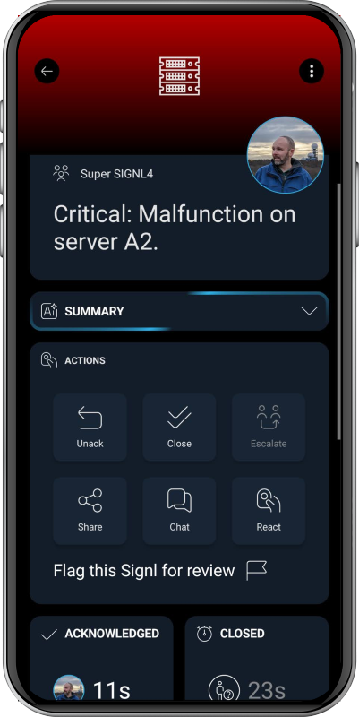

# SIGNL4 Integration with Fortinet

[Fortinet](https://www.fortinet.com/) provides network and cybersecurity solutions. Its FortiGate firewalls run FortiOS and can automatically react to security and system events using **Automation Stitches**.

SIGNL4 extends FortiGate with reliable mobile alerting via app push, SMS and voice calls, including automated escalation, on-call scheduling and acknowledgement. Instead of relying only on dashboards or email, critical firewall events can reach the person currently responsible for responding.

Some common use cases include:

* alerts for repeated administrator login failures
* critical firewall and security event notifications
* notification of important configuration changes
* on-call response to suspicious network activity
* escalation of security incidents outside business hours

## Prerequisites

* A [SIGNL4](https://www.signl4.com/) account and a team or integration webhook secret
* A Fortinet FortiGate running a FortiOS version that supports **Automation Stitches** and **Webhook** actions
* Administrator permissions to create automation triggers and actions
* Outbound HTTPS connectivity from FortiGate to `connect.signl4.com` on TCP port 443

## How to Integrate

FortiOS Automation Stitches connect an event **trigger** to one or more **actions**. A Webhook action can send an HTTPS request containing event information to SIGNL4. The following example uses the built-in **Admin login failed** event; adjust the trigger for your security use case.

### 1. Create the SIGNL4 Webhook

In SIGNL4, create or use an existing webhook integration for the team that should receive the alerts.

The webhook URL has the following format:

```text
https://connect.signl4.com/webhook/YOUR_SIGNL4_SECRET
```

Replace `YOUR_SIGNL4_SECRET` with your SIGNL4 team or integration secret. Treat the complete URL as a credential and do not expose it in logs or screenshots.

### 2. Create an Automation Stitch in FortiGate

1. Log in to the FortiGate administration interface.
2. Navigate to **Security Fabric > Automation**.
3. Click **Create New** and name the automation stitch, for example `SIGNL4 - Failed Admin Login`.
4. Click **Add Trigger** and select or create a **FortiOS Event Log** trigger.
5. Choose **Admin login failed** as the event and apply the trigger.

The precise labels and available events can differ between FortiOS versions.

### 3. Configure the Webhook Action

Click **Add Action > Create > Webhook** and configure the following fields:

| Setting | Value |
| --- | --- |
| Name | `Send to SIGNL4` |
| Protocol | `HTTPS` |
| URL | `https://connect.signl4.com/webhook/YOUR_SIGNL4_SECRET` |
| Custom port | `443` (if your version requires it) |
| Method | `POST` |
| HTTP header | `Content-Type: application/json` |

Depending on the FortiOS version, the GUI may ask for the URL or URI separately from the protocol and port. Follow the format expected by your version; do not duplicate `https://` if the field expects only a host/path.

Use this **static JSON** HTTP body for a straightforward first test:

```json
{
  "Title": "FortiGate: Administrator login failed",
  "Message": "FortiGate detected an unsuccessful administrator login. Review the event log.",
  "Severity": "High",
  "Device": "FortiGate",
  "Event": "Admin login failed",
  "X-S4-SourceSystem": "Fortinet FortiGate"
}
```

This static payload demonstrates the end-to-end alert path. For a more useful operational alert, you can include the event log using FortiOS's documented `%%log%%` substitution, or insert supported log fields into your JSON template. Check the actual substitution output and ensure the resulting body is valid JSON. FortiOS expression behavior can depend on the trigger and firmware version.

**Note:** Sending `%%log%%` as the entire HTTP body is documented by Fortinet, but its output is not guaranteed to match the custom SIGNL4 JSON example above. Use a JSON wrapper or a transformation service when you require a specific payload structure.

### 4. Save and Test the Automation Stitch

1. Save the Webhook action and attach it to your Automation Stitch.
2. Enable and save the stitch.
3. For the example trigger, perform a controlled unsuccessful administrator login from an authorized test environment.
4. Check **Log & Report > System Events** in FortiGate to confirm that the stitch was triggered.
5. Check the SIGNL4 mobile app for the resulting alert.

If no alert arrives, check FortiGate's outbound HTTPS connectivity, the configured URL, the HTTP request body and header, and the SIGNL4 webhook secret. Avoid generating repeated failed logins on a production firewall just for testing.

The communication path is:

```text
FortiGate security / system event
          |
          v
FortiOS Automation Stitch (trigger)
          |
          v
Webhook Action - HTTPS POST
          |
          v
SIGNL4
          |
          +--> Mobile push / SMS / voice call
          +--> On-call routing
          +--> Acknowledgement and escalation
```

### 5. Configure Alert Routing in SIGNL4

Use SIGNL4 to determine who should be notified and how critical alerts should be handled. Configure on-call schedules, notification channels and escalation rules for the receiving team. For example, have a high-priority firewall event notify the on-call security engineer, then escalate if it is not acknowledged.

You can create more FortiGate Automation Stitches for other event types. Consider filtering or grouping frequently occurring events to avoid unnecessary alert noise.

## Example

A FortiGate detects an administrator login failure and fires the configured Automation Stitch. The Webhook action sends an HTTPS POST request to SIGNL4. SIGNL4 notifies the responsible engineer through the configured channels, and the engineer can acknowledge the alert from the mobile app.

This is an illustrative SIGNL4 mobile alert screenshot (not a screenshot of a live FortiGate event):



That's it. FortiGate events can now trigger reliable mobile alerts, with on-call routing and escalation managed by SIGNL4.

## References

* [Fortinet: Webhook action (FortiOS 7.6.3)](https://docs.fortinet.com/document/fortigate/7.6.3/administration-guide/989735)
* [Fortinet: Slack integration webhook (FortiOS 7.6.6)](https://docs.fortinet.com/document/fortigate/7.6.6/administration-guide/261559/slack-integration-webhook) — reference example for HTTPS POST with JSON
* [Fortinet: Automation Stitches (FortiOS 7.6.6)](https://docs.fortinet.com/document/fortigate/7.6.6/administration-guide/139441/automation-stitches)
* [SIGNL4 Webhook Integration](https://docs.signl4.com/integrations/webhook/)
