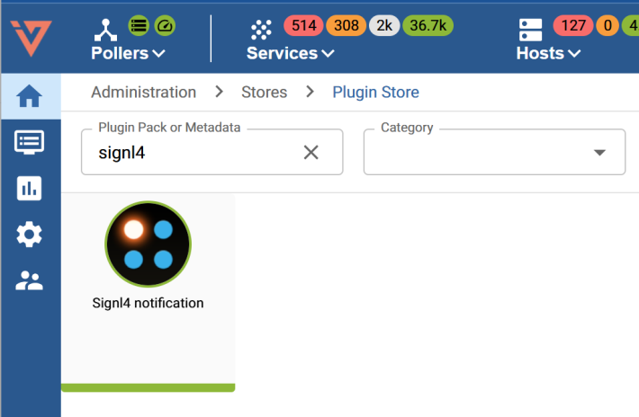
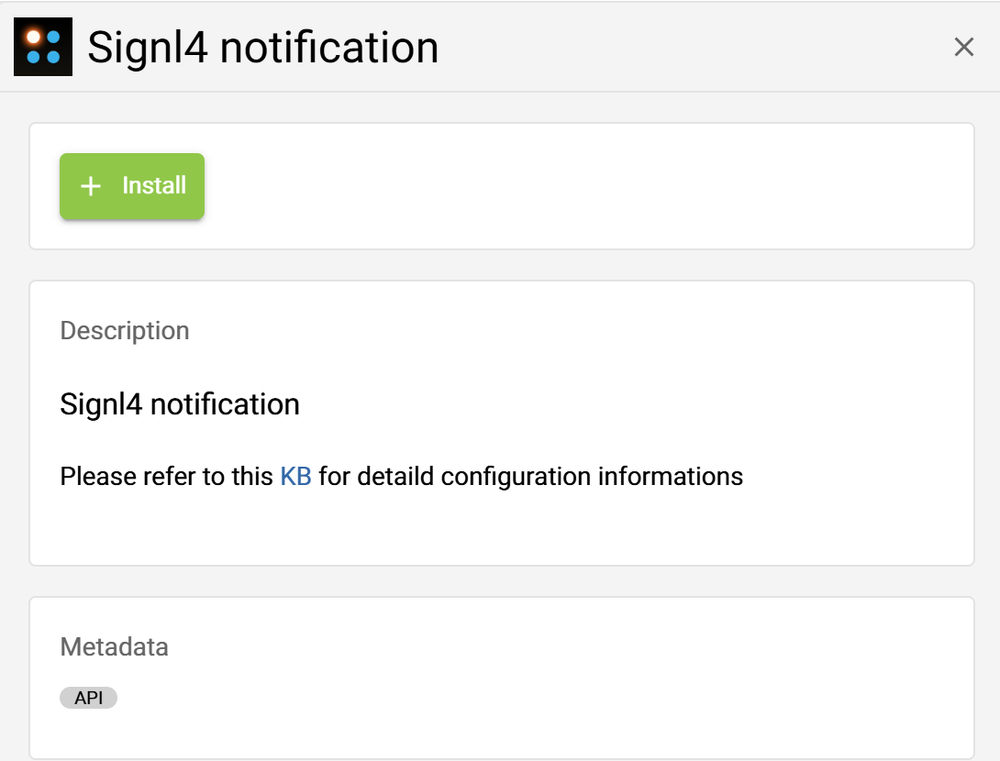
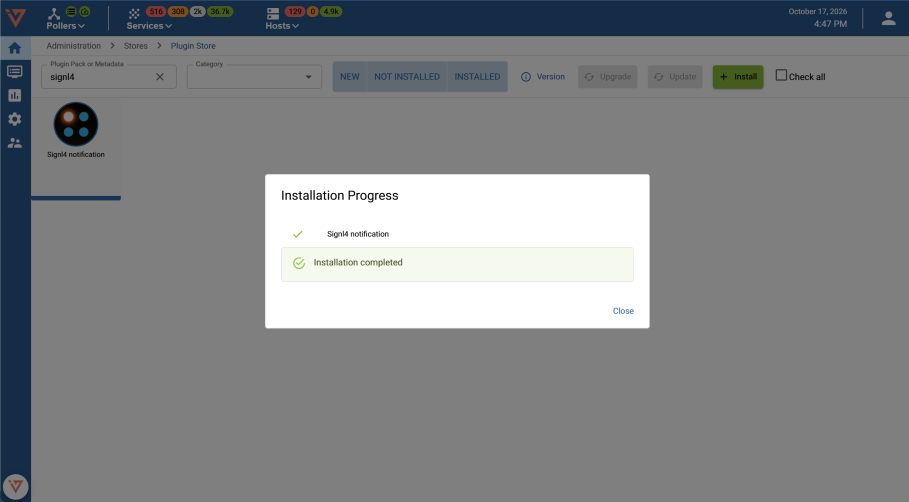
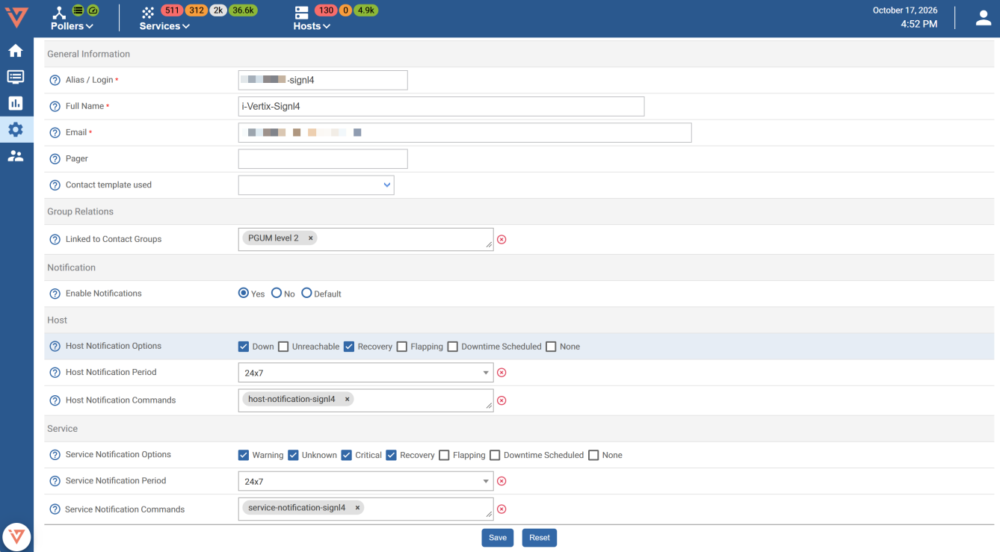
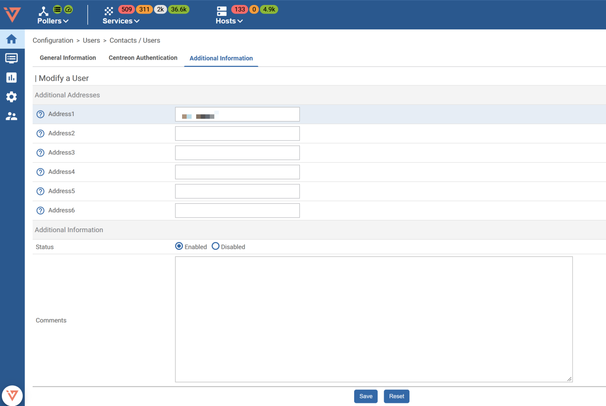
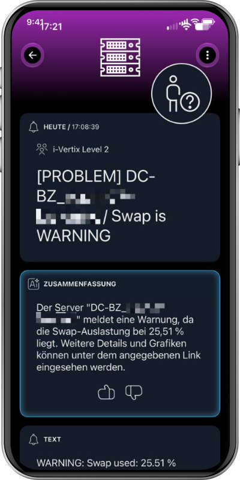
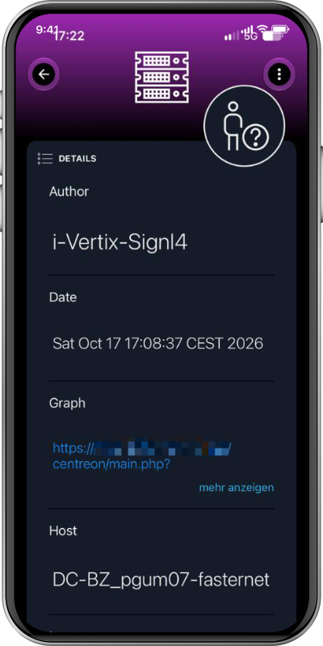
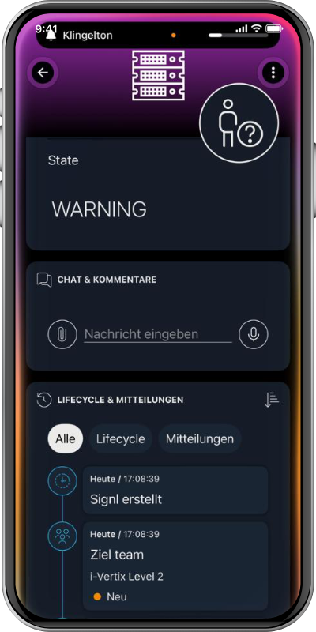
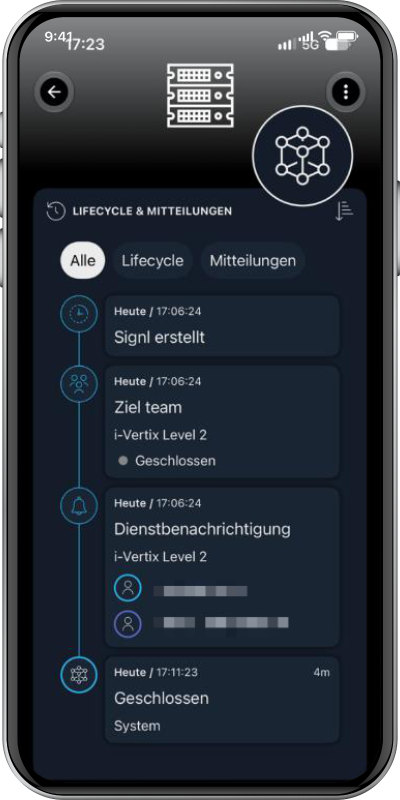
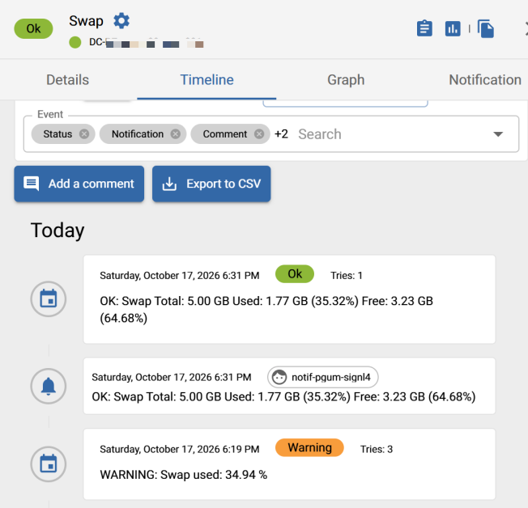

# SIGNL4 Integration with i-Vertix

[i-Vertix](https://www.i-vertix.com/) provides IT monitoring and management solutions for managed service providers (MSPs) and IT teams, covering network monitoring, log and data management, and IT asset management. Its **Signl4 notification** plugin connects monitoring notifications to [SIGNL4](https://www.signl4.com/) for reliable mobile alerting and incident response.

SIGNL4 notifies the responsible on-call staff via app push, SMS and voice calls, with duty scheduling and automated escalation if an alert is not acknowledged. Monitoring information is available directly in the mobile alert.

Typical use cases include:

- Notifying on-call engineers about critical host and service problems.
- Alerting MSP support teams to infrastructure and network failures.
- Escalating disk, memory, CPU or service warnings outside business hours.
- Providing monitoring context and links to the affected host or service.
- Automatically closing SIGNL4 alerts when the corresponding i-Vertix problem is resolved.

## Prerequisites

- An operational i-Vertix monitoring installation with access to **Administration → Stores → Plugin Store**.
- A [SIGNL4 account](https://www.signl4.com/) and a configured team/on-call schedule.
- Permission to install plugins and configure i-Vertix users, contacts and notifications.
- Access to the i-Vertix [SIGNL4 plugin knowledge-base article](https://helpdesk.i-vertix.cloud/front/knowbaseitem.form.php?id=137) for the precise configuration of the plugin and its required credentials.

## How to Integrate

The integration uses the **Signl4 notification** plugin available from the i-Vertix Plugin Store. The supplied i-Vertix documentation demonstrates the following installation and user setup.

### 1. Install the SIGNL4 notification plugin

1. Sign in to the i-Vertix web interface with administrative permissions.
2. Navigate to **Administration → Stores → Plugin Store**.
3. Search for `signl4`.
4. Open **Signl4 notification** and select **Install**.
5. Wait until the installation completes successfully.







### 2. Configure the notification contact

In i-Vertix, open **Configuration → Users → Contacts / Users** and edit the contact that should receive SIGNL4 notifications.

In the contact's **General Information** tab:

1. Enable notifications for the contact.
2. Select appropriate **Host Notification Options** and **Service Notification Options**. For example, the illustrated configuration enables host **Down** notifications and service **Warning**, **Unknown**, and **Critical** notifications.
3. Set the host and service notification periods (the example shows `24x7`).
4. Select the installed SIGNL4 notification commands for host and service notifications.
5. Save the configuration.

The exact notification options depend on which monitoring events should trigger mobile alerts.



### 3. Complete the plugin-specific user configuration

The supplied screenshots also show an **Additional Information** tab with contact address fields (including **Address1**). Complete the SIGNL4-specific fields as required by the plugin's configuration guide, then save the contact.

> **Important:** The source document does not explain the meaning of the example Address1 value, the required team secret, or the plugin's backend settings. Do not assume the field's purpose from the screenshot alone. Follow the [official i-Vertix configuration article](https://helpdesk.i-vertix.cloud/front/knowbaseitem.form.php?id=137) for the exact field mapping and authentication setup.



### 4. Test a host or service alert

Trigger a test notification using a suitable test host or service, or wait for a monitored issue to enter a problem state. Check that:

1. The i-Vertix event appears in the host or service timeline.
2. SIGNL4 receives a new alert with relevant information about the monitored system.
3. An on-call responder can acknowledge the alert in SIGNL4.
4. When the issue is resolved in i-Vertix, the corresponding SIGNL4 alert closes automatically.

The example in the supplied document is a swap-usage warning on a monitored server. The resulting SIGNL4 alert contains the host name, current warning and a link to the monitoring graph.





## Alert Workflow

The integration described by i-Vertix supports the following lifecycle:

```text
i-Vertix host / service changes to a problem state
          |
          v
i-Vertix Signl4 notification plugin
          |
          v
SIGNL4 creates a mobile alert
          |
          +--> On-call routing and escalation
          +--> Acknowledge in SIGNL4
          |
          v
i-Vertix detects recovery / problem resolution
          |
          v
Corresponding SIGNL4 alert closes automatically
```

The integration's **automatic close on i-Vertix recovery** is documented in the supplied i-Vertix guide. It does not state that acknowledging an alert in SIGNL4 changes the acknowledgement status back in i-Vertix.







## Troubleshooting

If alerts are not delivered:

- Confirm that **Signl4 notification** installed successfully and is available as a notification command.
- Verify that notifications are enabled on the contact and that the relevant host/service notification types are selected.
- Check the notification period and contact assignment for the affected host or service.
- Check that the plugin's SIGNL4 credentials and other required fields follow the [i-Vertix knowledge base](https://helpdesk.i-vertix.cloud/front/knowbaseitem.form.php?id=137).
- Inspect i-Vertix notification and event history, then verify delivery in SIGNL4.
- Test both a problem notification and a recovery notification to confirm the full alert lifecycle.

## References

- [i-Vertix](https://www.i-vertix.com/)
- [i-Vertix: Signl4 notification plugin - configuration knowledge base](https://helpdesk.i-vertix.cloud/front/knowbaseitem.form.php?id=137)
- [SIGNL4](https://www.signl4.com/)

*This guide is based on the i-Vertix document “i-Vertix Signl4 Integration – Screenshots & Infos for Signl4 Integration Website”, version 1.0, dated October 17, 2026. Plugin configuration details not specified there are explicitly left to the official i-Vertix knowledge base. The procedure has not been independently tested against a live installation.*
