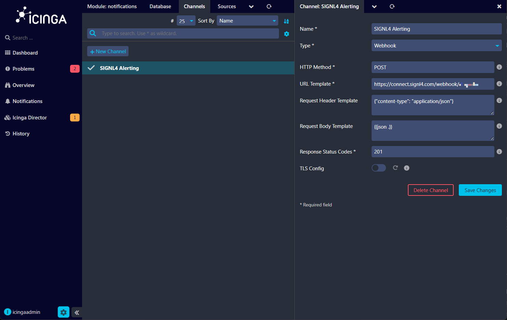
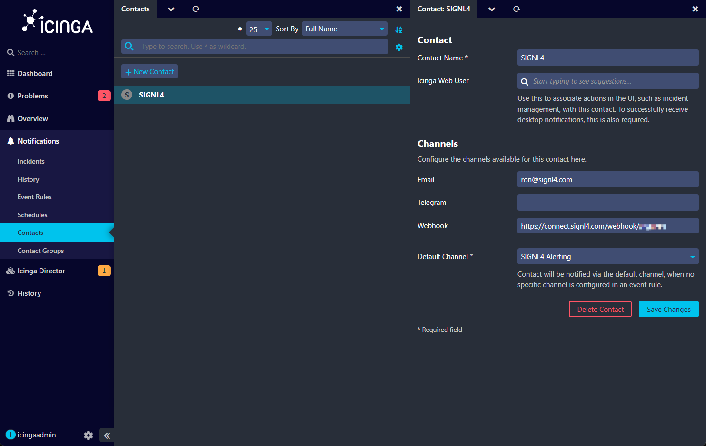
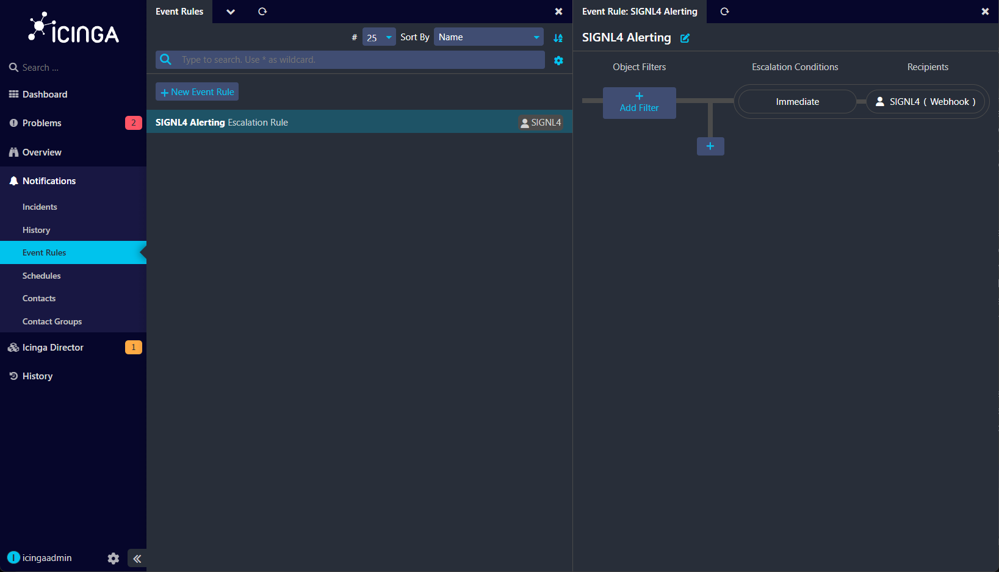
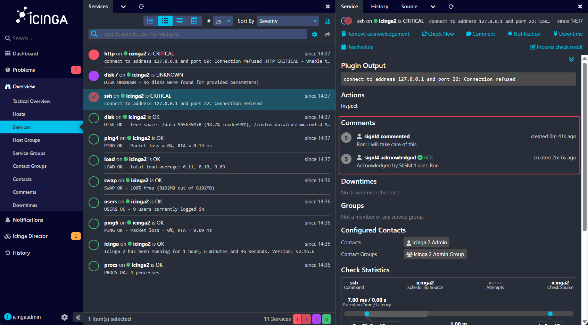

# SIGNL4 Integration with Icinga

[Icinga](https://icinga.com/) monitors the availability and performance of hosts, services, networks and applications. SIGNL4 complements Icinga with reliable mobile alerting and incident response via app push, SMS and voice calls, including on-call scheduling, automated escalation and acknowledgements.

Whether a critical server becomes unavailable overnight, a database runs out of disk space or a network connection fails, SIGNL4 alerts the right engineer on duty and helps reduce response times and downtime.

## Option 1: Icinga Notifications

With [Icinga Notifications](https://icinga.com/docs/icinga-notifications/latest/) (version 1.0 or later), you can send alerts directly to SIGNL4 using the built-in webhook channel. No custom notification script is required.

### Prerequisites

- An Icinga installation with Icinga DB, Icinga Notifications and Icinga Notifications Web configured.
- Icinga DB configured as a notification source. See the [Icinga Notifications Web configuration guide](https://icinga.com/docs/icinga-notifications-web/latest/doc/03-Configuration/).
- A [SIGNL4](https://www.signl4.com/) team and its incoming webhook URL.
- Outbound HTTPS connectivity from Icinga Notifications to `connect.signl4.com`.

### Configure the SIGNL4 webhook channel

In Icinga Web, navigate to **Configuration -> Modules -> notifications -> Channels** and add a new channel with the following settings:

| Setting | Value |
| --- | --- |
| Name | SIGNL4 Alerting |
| Type | Webhook |
| HTTP Method | POST |
| URL Template | `https://connect.signl4.com/webhook/<team-secret>` |
| Content-Type (HTTP header) | `{"content-type": "application/json"}` |
| Request Body Template | See example below |
| Response Status Codes | `201` |

Replace `<team-secret>` with your SIGNL4 team secret or use the complete incoming webhook URL from your SIGNL4 integration. Keep this URL confidential.

Use the following example as the **Request Body Template**. Icinga uses Go templates; the `json` function ensures that dynamic values are correctly encoded for JSON.



```json
{
  "Title": "Icinga monitoring alert",
  "Message": {{json .Event.Message}},
  "Source": "Icinga",
  "Details": {{json .Object.Url}},
  "Tags": {{json .Object.Tags}}
}
```

You also might want to keep it as is to use the full JSON.

```json
{{json .}}
```



Save the channel. For more information about alert payloads and optional parameters, see the [SIGNL4 webhook documentation](https://docs.signl4.com/integrations/webhook/).



### Configure a contact

Go to **Notifications -> Contacts** and create a contact named `SIGNL4`. Select **SIGNL4 Alerting** as its default channel. If a channel address is required by your configuration, supply the appropriate value; the webhook URL above already defines the destination and does not use the contact address.

A single contact is sufficient for each SIGNL4 team. SIGNL4 takes care of routing alerts to the people on duty and escalating them if necessary.



### Configure an event rule

Navigate to **Notifications -> Event Rules** and create a new rule:

1. Enter a title, for example `SIGNL4 Alerting`.
2. Select **Icinga** as the source type.
3. Select **Escalation Rule** to notify SIGNL4 when an incident opens. Alternatively, use a **Notification Rule** to select specific event types.
4. Configure an object filter if you only want to alert for certain hosts or services.
5. For an escalation rule, configure the initial escalation and add the SIGNL4 contact as a recipient. Select **SIGNL4 Alerting** as the channel or use the contact's default channel. For a notification rule, select the relevant problem event types and add the same recipient.
6. Save the rule.

If SIGNL4 handles on-call routing and escalation, an immediate initial escalation in Icinga is usually sufficient. Avoid overlapping rules or additional escalation stages that would send duplicate alerts to the same SIGNL4 team.



### Test the integration

Trigger a test problem on a monitored host or service that matches your event rule. You should receive an alert in the SIGNL4 app, with additional SMS or voice notifications according to your team settings.

Check **Notifications -> History** in Icinga Web to verify that the notification was delivered successfully. If no alert arrives, check the event rule, recipient, webhook URL and outbound HTTPS connectivity.

The example above sends incoming alerts only. Automatic resolution and acknowledgement synchronization require additional status and identifier mapping; recovery events should not be sent as new alerts. The existing connector described below is based on the Icinga 2 API and should be validated separately before combining it with this notification method.

## Option 2: Notification script

For installations using classic Icinga 2 notifications, we provide a ready-made script that sends alerts directly to your SIGNL4 team.

### SIGNL4 Script

Download the notification script and move it to the Icinga 2 scripts directory:

```bash
wget https://raw.githubusercontent.com/signl4/signl4-integration-icinga2/master/signl4-notification.sh
chmod +x signl4-notification.sh
mv signl4-notification.sh /etc/icinga2/scripts/
```

### SIGNL4 Configuration

Download the configuration file and move it to the configuration directory:

```bash
wget https://raw.githubusercontent.com/signl4/signl4-integration-icinga2/master/signl4-icinga2.conf
mv signl4-icinga2.conf /etc/icinga2/conf.d/
```

The configuration defines the notification logic and creates the user `signl4`. Enter your SIGNL4 team secret in the user's `pager` field:

```
pager = "team-secret"
```

### Activate SIGNL4 Alerting

In `/etc/icinga2/conf.d/templates.conf`, add the following line to the existing `generic-host` and `generic-service` templates:

```
vars.enable_signl4 = true
```

Keep the existing template settings unchanged. Alternatively, set the variable on the individual hosts and services for which you want to enable SIGNL4 notifications.

### Service Restart

Validate the configuration and restart Icinga 2:

```bash
icinga2 daemon -C
service icinga2 restart
```

### Test the integration

Open a monitored service in Icinga Web and send a custom notification. Enable the **Forced** option if necessary. You should receive an alert in your SIGNL4 app.

Find the script and additional information on [GitHub](https://github.com/signl4/signl4-integration-icinga2).

## Two-way integration

For two-way communication with Icinga 2, the Icinga connector app is available in SIGNL4 under **Integrations -> Gallery -> Icinga**. It allows you to acknowledge, close or annotate Icinga events directly from the SIGNL4 app when the incoming alerts contain the information required by the connector.

Enable the Icinga 2 API and configure the connector with the API username, password and the reachable URL of your Icinga server. Verify the status synchronization with your selected notification method before using it in production.

> **Note:** For two-way integrations, SIGNL4 may need to send acknowledgements, status updates, or closures back to an on-premises system. This requires secure inbound connectivity, for example via a firewall, reverse proxy, VPN, tunnel, or gateway. [Learn more about back-channel connectivity](https://docs.signl4.com/samples/back-channel-connectivity/).



The alert in SIGNL4 might look like this:


