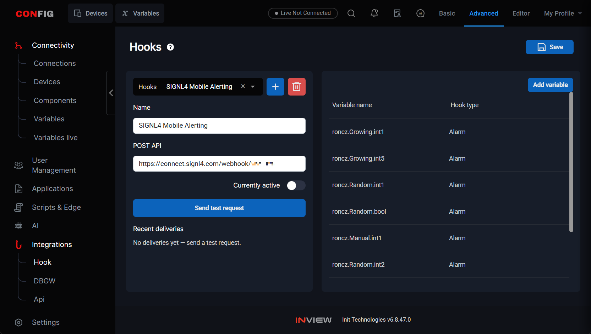

# SIGNL4 Integration with inVIEW SCADA

[inVIEW SCADA](https://www.inviewscada.com/) is a web-based supervisory control and data acquisition (SCADA) platform for monitoring industrial processes, equipment, and IoT devices. It supports connectivity to systems such as PLCs, gateways, and sensors using protocols including MQTT, OPC UA, and Modbus TCP. It can be deployed in the cloud or locally, including on edge devices.

Industrial alarms should reach the people who can take action, even when nobody is watching the SCADA dashboard. Connecting inVIEW SCADA with [SIGNL4](https://www.signl4.com/) brings critical process and equipment events to the on-call technician's phone via app push, SMS, and voice calls. SIGNL4 adds acknowledgement, duty scheduling, and automated escalation if nobody responds.

Typical use cases include:

* **Production equipment:** Notify the on-call maintenance engineer when a motor, conveyor, or production line reports a critical fault.
* **Temperature and pressure:** Escalate process readings outside safe operating thresholds before they lead to downtime or damage.
* **Utilities and infrastructure:** Alert the responsible operator about pump failures, tank levels, or abnormal water and energy measurements.
* **Remote sites and edge devices:** Deliver alarms from machines or remote facilities without requiring someone to keep a dashboard open.
* **Connectivity and device health:** Notify a technician when a monitored gateway or other equipment goes offline, provided a corresponding condition is configured in inVIEW SCADA.

## Prerequisites

* A [SIGNL4](https://www.signl4.com/) account and a team or integration secret.
* Access to an inVIEW SCADA project with permission to configure **Integrations > Hook** and **Scripts & Edge > Scripts**.
* Relevant variables or alarm conditions in inVIEW SCADA.
* Outbound HTTPS connectivity to `connect.signl4.com` on port 443 from the system executing the Hook, especially for local or edge deployments.

## How to Integrate

The integration sends an HTTPS POST request to SIGNL4's inbound webhook. In inVIEW SCADA, first configure a reusable **Hook** for the SIGNL4 endpoint, then use it from a script associated with the relevant condition or event.

```text
PLC / Sensor / IoT Device
           |
           v
       inVIEW SCADA
           |
     Alarm / Script
           |
           v
   Configured HTTP Hook
           |
           v
         SIGNL4
           |
  Push / SMS / Voice Calls
           |
  On-call Routing & Escalation
```

### 1. Get Your SIGNL4 Webhook URL

In SIGNL4, open the target team and copy its team or integration secret. The webhook URL has this format:

```text
https://connect.signl4.com/webhook/YOUR_SIGNL4_SECRET
```

Replace `YOUR_SIGNL4_SECRET` with the actual secret. The URL contains a credential, so do not publish it in scripts, public repositories, or unredacted screenshots.

See the [SIGNL4 Webhook Integration](https://docs.signl4.com/integrations/webhook/) for additional options.

### 2. Create the inVIEW SCADA Hook

1. Sign in to your inVIEW SCADA project and switch to **Advanced**, if necessary.
2. Go to **Integrations > Hook**.
3. Add a Hook and give it a descriptive name, for example **SIGNL4 Mobile Alerting**.
4. In **POST API**, paste the SIGNL4 webhook URL from step 1.
5. Under **Add variable**, select the relevant project variables and configure their Hook type as **Alarm**, where appropriate. The available variables and alarm conditions depend on your project.
6. Set **Currently active** to enabled and click **Save**.
7. Click **Send test request** to check delivery, then inspect **Recent deliveries** for any available status or error details.



*Example inVIEW SCADA Hook configuration. The screenshot shows the activation control switched off; enable it before using the Hook for operational alerting. The webhook secret is obscured.*

### 3. Trigger the Hook from a Script

Go to **Scripts & Edge > Scripts** and create or edit a script for the machine condition, alarm, or event you want to notify on. Use the **SIGNL4 Mobile Alerting** Hook created above as the destination. For edge deployments, make sure the execution environment can reach the SIGNL4 webhook.

For example, your script might detect a motor temperature above its configured threshold and send the following alert data:

```json
{
  "Title": "inVIEW SCADA: Motor temperature high",
  "Message": "Motor M1 temperature exceeded the limit (89 C; threshold 85 C).",
  "Source": "inVIEW SCADA",
  "Equipment": "Motor M1",
  "Temperature": "89 C",
  "Threshold": "85 C"
}
```

**Illustrative script logic (pseudocode):**

```javascript
if (motorTemperature > 85) {
  // Replace sendConfiguredHook with the Hook invocation method
  // supported by your inVIEW SCADA script runtime.
  sendConfiguredHook("SIGNL4 Mobile Alerting", {
    Title: "inVIEW SCADA: Motor temperature high",
    Message: `Motor M1 temperature is ${motorTemperature} C (limit: 85 C).`,
    Equipment: "Motor M1",
    Source: "inVIEW SCADA"
  });
}
```

> **Script API note:** `sendConfiguredHook()` is a **placeholder, not a verified inVIEW SCADA function**. The inVIEW screenshot confirms Hook configuration, but the exact method for invoking a named Hook from a script is not documented in the publicly accessible material used for this guide. Replace the placeholder with the function or action exposed in your inVIEW script editor. The example shows the intended condition and payload, not code that can be pasted into every inVIEW runtime unchanged.

For reference, a direct **JavaScript HTTP POST** to SIGNL4 would look like this:

```javascript
fetch("https://connect.signl4.com/webhook/YOUR_SIGNL4_SECRET", {
  method: "POST",
  headers: { "Content-Type": "application/json" },
  body: JSON.stringify({
    Title: "inVIEW SCADA: Motor temperature high",
    Message: "Motor M1 is above its temperature limit.",
    Source: "inVIEW SCADA"
  })
});
```

This last example sends the alert **directly** rather than through the saved inVIEW Hook. It is only suitable if the inVIEW script runtime supports `fetch()` and outbound HTTPS; that support has not been verified. Prefer the configured Hook to avoid repeating the webhook URL in scripts.

### 4. Test the Alert

1. First use **Send test request** on the Hook configuration page. Check for a new alert in the SIGNL4 app.
2. Trigger the relevant condition in a safe test environment, or run the configured script using inVIEW's supported testing mechanism.
3. Verify that the event reaches SIGNL4 with meaningful equipment details.
4. Check on-call routing, acknowledgement, and escalation in your SIGNL4 team.
5. For cloud or edge deployments, repeat the test from the actual execution environment.

## Example

A pump at a remote facility stops unexpectedly. inVIEW SCADA detects the equipment fault, and the configured Hook sends an event to SIGNL4. The on-call maintenance engineer receives a mobile alert with the equipment and fault details. If there is no response, SIGNL4 escalates to the next person according to the team's settings.

This is a **one-way alerting integration**. Acknowledging or closing the alert in SIGNL4 does not automatically acknowledge or clear the alarm in inVIEW SCADA. Such feedback would require a separately configured reverse integration.


*Illustrative SIGNL4 IoT alert. The actual title and details depend on the notification email configured in Cloud Studio IoT.*

## Troubleshooting

* **No alert from the Hook test:** Check the full SIGNL4 webhook URL, verify that **Currently active** is enabled, save the configuration, and review **Recent deliveries**.
* **Hook test works, but the script does not:** Verify the script's execution conditions, Hook selection, and actual inVIEW Script API syntax. The illustrative `sendConfiguredHook()` placeholder is not an executable function.
* **No alert from an edge device:** Check DNS resolution and outbound HTTPS connectivity to `connect.signl4.com:443` from the edge runtime.
* **Incorrect or missing alert details:** Review variable selection, payload mapping, and the JSON values passed to the webhook.
* **Repeated alerts:** Trigger on meaningful state changes or apply suitable thresholds, hysteresis, or delays so a continually true condition does not generate an unnecessary alert storm.

## References

* [inVIEW SCADA](https://www.inviewscada.com/)
* [inVIEW SCADA Use Cases](https://www.inviewscada.com/use-cases/)
* [SIGNL4 Webhook Integration](https://docs.signl4.com/integrations/webhook/)
* [SIGNL4 Webhook Code Samples](https://docs.signl4.com/samples/code-samples/)

That's it. inVIEW SCADA alarms can now reach the responsible on-call people with reliable mobile notifications and automated escalation, instead of waiting to be noticed on a dashboard.
