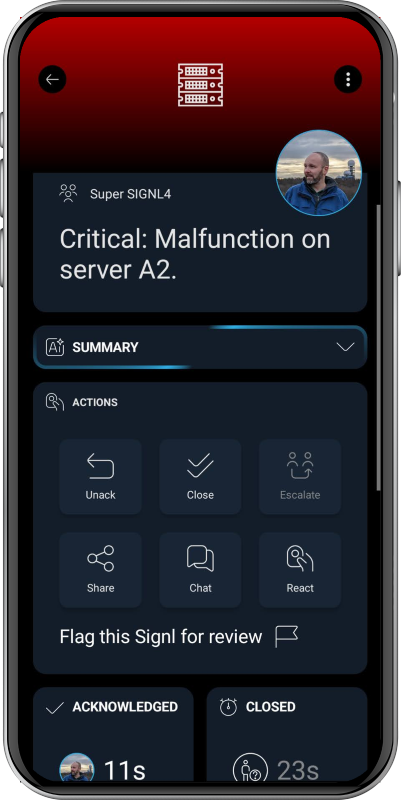

# SIGNL4 Integration with Mugnsoft

[Mugnsoft](https://mugnsoft.com/) is an application performance monitoring platform for monitoring applications, services, and infrastructure across distributed environments. It helps teams identify availability and performance issues so they can act before these affect users and business operations.

SIGNL4 extends Mugnsoft with reliable mobile alerting via app push notifications, SMS messages, and voice calls, along with automated escalations, on-call scheduling, and mobile acknowledgements. When Mugnsoft detects a problem, SIGNL4 notifies the responsible team. Once the monitor recovers, Mugnsoft can automatically resolve the corresponding SIGNL4 alert.

Some common use cases include:
- mobile alerts when a website or API becomes unavailable
- on-call notification when an application or service monitor fails
- escalation of critical availability or performance issues
- notifications for failed container or host checks
- automatic resolution of alerts when monitored services recover

## Prerequisites

- A [SIGNL4](https://www.signl4.com/) account
- A Mugnsoft installation with SIGNL4 notification support (version 4.3.1 or later on relevant Webserver, Integrator, probes, and Sentinel agents)
- Permission to configure Mugnsoft notifications and access to the receiving SIGNL4 team's secret or webhook integration URL

## How to Integrate

Mugnsoft has built-in support for SIGNL4 notifications. You can configure SIGNL4 as the default notification destination for an Integrator or configure it individually for monitors, applications, Sentinel agents, and container hosts.

### 1. Get Your SIGNL4 Webhook

1. Sign in to the SIGNL4 web portal with a manager account.
2. Open **Teams** and select the team that should receive Mugnsoft alerts.
3. Copy the team's secret, or create a dedicated **Webhook** integration under **Integrations** and copy its secret or URL.

The webhook URL has this format:

```text
https://connect.signl4.com/webhook/YOUR_SIGNL4_SECRET
```

`YOUR_SIGNL4_SECRET` is the team or integration secret. Keep it confidential, as anyone with the secret can send alerts to the team.

### 2. Configure SIGNL4 in Mugnsoft

To use SIGNL4 as the default notification destination for monitors of an Integrator:

1. In Mugnsoft, open **Integrator → General → Notifications → SIGNL4**.
2. Enable **On fail** and/or **On change**, depending on when alerts should be sent.
3. Enter your SIGNL4 team or integration secret in **Default team secret**. You can also provide the full SIGNL4 webhook URL.
4. Save the settings using the disk icon.

The default secret can be reused by individual monitors without configuring it again.

### 3. Configure Notifications for Individual Monitors

You can also configure SIGNL4 notifications for specific monitors:

1. Open the monitor in Mugnsoft and navigate to **Actions → SIGNL4**.
2. Enable **On fail** and/or **On change**.
3. Leave **Team secret** empty to use the Integrator's default, or enter a different SIGNL4 team secret to route the monitor's alerts to another team.
4. Save your changes using the disk icon.

The same SIGNL4 notification card is available for applications, Sentinel agents, and container hosts.

The two trigger options behave as follows:

- **On fail:** Raises an alert when the configured failure rule is met, for example after repeated errors. When the monitor returns to OK, Mugnsoft automatically resolves the SIGNL4 alert.
- **On change:** Sends notifications when the monitor changes status, including recovery to OK.

Choose **On fail** for persistent failures or **On change** to track each status transition. Mugnsoft avoids sending duplicate events when a failure also represents a status change.

### 4. Test the Integration

In the Mugnsoft Integrator's **Notifications** section, click the lightning-bolt (**⚡**) test button on the SIGNL4 card. Mugnsoft sends a test alert and then resolves it immediately.

The test generates an alert with a title similar to:

```text
[TEST] Mugnsoft notification test
```

The test notifies the on-call team, so inform team members beforehand.

Alternatively, you can test the SIGNL4 webhook manually with two HTTP requests. First, raise an alert:

```bash
curl -s -X POST https://connect.signl4.com/webhook/YOUR_SIGNL4_SECRET \
  -H "Content-Type: application/json" \
  -d '{"Title":"Mugnsoft test alert","Message":"Test from Mugnsoft","X-S4-ExternalID":"mugnsoft-test","X-S4-Status":"new"}'
```

Then resolve that same alert:

```bash
curl -s -X POST https://connect.signl4.com/webhook/YOUR_SIGNL4_SECRET \
  -H "Content-Type: application/json" \
  -d '{"X-S4-ExternalID":"mugnsoft-test","X-S4-Status":"resolved"}'
```

Each successful call should return HTTP 200 or 201 with an `eventId`. Replace `YOUR_SIGNL4_SECRET` with your secret before testing.

### 5. Understand Alert Updates and Resolution

Mugnsoft correlates notifications from the same monitor with the SIGNL4 field `X-S4-ExternalID`. The identifier combines the probe, monitor type, and monitor name, so the same monitor can update or resolve its existing SIGNL4 alert.

- When a monitor reports a non-OK state, Mugnsoft sends `X-S4-Status: new`.
- When the monitor returns to OK, Mugnsoft sends `X-S4-Status: resolved`.
- The notification includes information such as the monitor, status, target, probe, check time, and a link to locate the monitored item in Mugnsoft's 3D view.
- Mugnsoft uses `X-S4-Service` to pass the monitor type, which SIGNL4 can use for alert categorization.

For example, an unavailable web service might generate an alert titled:

```text
[CRITICAL] web-shop · HTTP 503 · probe-paris
```

When the service becomes available again, Mugnsoft automatically closes the associated SIGNL4 alert. Monitoring the same service from multiple probes can produce separate alerts for each probe.

### 6. Troubleshooting

If notifications do not arrive, verify the following:

- **Invalid secret or webhook URL:** Copy the SIGNL4 secret or webhook URL again. Mugnsoft accepts only valid SIGNL4 destinations.
- **HTTP 4xx errors:** Check whether the SIGNL4 secret is incorrect or revoked.
- **No mobile notification:** Check that the intended SIGNL4 team has someone on duty and that the relevant alert category is not muted.
- **Alert not resolved:** Confirm that Mugnsoft observed the recovery event; probe status-change debounce settings can delay or suppress a recovery notification if the monitor fails again.
- **Multiple alerts:** Mugnsoft intentionally creates separate alerts for individual monitors and probes.

For more information, see the [Mugnsoft SIGNL4 documentation](https://doc.mugnsoft.com/notifications/signl4/).

That's it.

Your Mugnsoft monitoring events can now reach the right on-call personnel through SIGNL4 via app push, SMS, or voice call, with acknowledgement and automated escalation. SIGNL4 alerts are also resolved automatically when the corresponding Mugnsoft monitor recovers.

The alert in SIGNL4 can look like this:


