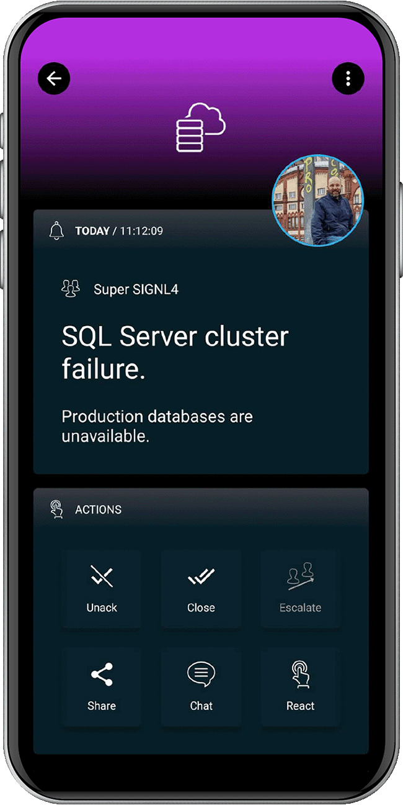

# SIGNL4 Integration with Nagios

[Nagios](https://www.nagios.com/) monitors IT infrastructure, hosts and services and detects problems before they become major outages. But critical events still need to reach the right people, even when they are away from their desks.

SIGNL4 extends Nagios with reliable mobile alerting via app push, SMS and voice calls. On-call schedules automatically route notifications to the responsible engineers, while acknowledgements and automated escalation help ensure that urgent issues are not overlooked.

## Why Integrate Nagios with SIGNL4?

- **Reach engineers anywhere:** Notify on-call teams about critical host and service problems through app push, SMS and voice calls.
- **Automate escalation:** Escalate unacknowledged alerts to other team members.
- **Route alerts by schedule:** Contact the people currently on duty instead of maintaining separate notification lists in Nagios.
- **Track incident ownership:** Team members can acknowledge and manage alerts in the SIGNL4 mobile app.
- **Handle recoveries:** The SIGNL4 Nagios plugin includes logic for resolving corresponding alerts when Nagios reports recovery.

## Typical Use Cases

- Critical server, network or host failures
- Unavailable websites and application services
- Database, storage or disk-space problems
- After-hours incidents requiring on-call response
- Monitoring alerts that must reach field engineers or operations teams

## How It Works

1. Nagios detects a host or service problem and executes a configured notification command.
2. The SIGNL4 Nagios plugin sends the event to the SIGNL4 webhook endpoint using HTTPS.
3. SIGNL4 notifies the appropriate team members according to their on-call schedules and alerting preferences.
4. Team members acknowledge the alert, or SIGNL4 escalates it according to the configured rules.
5. When Nagios sends a recovery notification, the plugin can resolve the associated SIGNL4 alert.

## Prerequisites

- A running Nagios Core or Nagios XI installation with permission to configure notification commands and contacts
- A [SIGNL4 account](https://www.signl4.com/) and a configured team
- The SIGNL4 team webhook URL, including the team secret
- Outbound HTTPS access from the Nagios server to SIGNL4
- `bash` and `curl` on the Nagios server, as used by the provided notification scripts

## Setup

### 1. Download the SIGNL4 Nagios Plugin

Download the plugin from the [Nagios Exchange](https://exchange.nagios.org/directory/plugins/notifications/signl4-it-on-2dcall-alerting-and-duty-scheduling/details/) or view its source code on [GitHub](https://github.com/signl4/signl4-plugin-nagios).

The package includes:

- `signl4_host_notify.sh` — handles host notifications
- `signl4_service_notify.sh` — handles service notifications
- `signl4_commands.cfg` — example Nagios command definitions

### 2. Configure the Webhook URL

Copy both shell scripts into your Nagios plugin directory. The directory depends on your installation; a common location is `/usr/local/nagios/libexec/`.

Open **both** scripts and replace the placeholder team secret in the `SIGNL4_URL` setting with your actual SIGNL4 team secret:

```bash
SIGNL4_URL=https://connect.signl4.com/webhook/<team-secret>
```

Make both scripts executable:

```bash
chmod +x /usr/local/nagios/libexec/signl4_host_notify.sh
chmod +x /usr/local/nagios/libexec/signl4_service_notify.sh
```

Adjust the paths to match your Nagios installation. Keep the webhook URL and team secret confidential.

### 3. Configure Nagios Notification Commands

Use the `signl4_commands.cfg` supplied with the plugin to define the `signl4-host` and `signl4-service` notification commands.

Make sure the command definitions are loaded by Nagios and that their script paths match the actual location of the scripts. If you store the supplied file separately, include it in your Nagios configuration through the appropriate `cfg_file` or `cfg_dir` setting.

**Tip:** Use the original command definitions from the plugin repository, since they pass the required Nagios notification macros to the scripts in the expected order.

### 4. Assign the Commands to a Nagios Contact

Create a dedicated SIGNL4 contact or add the notification commands to an existing contact. For example:

```cfg
define contact {
    contact_name                    signl4
    alias                           SIGNL4 On-Call Team
    host_notifications_enabled      1
    service_notifications_enabled   1
    host_notification_period        24x7
    service_notification_period     24x7
    host_notification_options       d,u,r
    service_notification_options    w,u,c,r
    host_notification_commands      signl4-host
    service_notification_commands   signl4-service
}
```

Assign the contact to the relevant hosts, services or contact groups in Nagios. You can also keep existing email notification commands alongside the SIGNL4 commands if required.

The example enables notifications for host DOWN/UNREACHABLE and recovery events, and service WARNING/UNKNOWN/CRITICAL and recovery events. Adjust these options to your monitoring and alerting policy.

### 5. Validate and Reload Nagios

Validate the configuration before applying it. On a typical Nagios Core installation:

```bash
/usr/local/nagios/bin/nagios -v /usr/local/nagios/etc/nagios.cfg
```

If validation succeeds, reload or restart Nagios using the method appropriate for your installation.

### 6. Test the Integration

1. Trigger a test notification or simulate a host or service problem in Nagios.
2. Confirm that the notification command runs and the event reaches SIGNL4.
3. Check that the team member currently on call receives a mobile alert.
4. Test acknowledgement and escalation in SIGNL4.
5. Generate a recovery notification and verify that the corresponding alert is resolved in SIGNL4.

## Alert Example

The resulting mobile alert can contain the affected host or service, its state and additional diagnostic information from Nagios.



## Troubleshooting

| Problem | What to Check |
| --- | --- |
| No SIGNL4 alert arrives | Confirm that Nagios notifications are enabled, the contact is assigned to the affected host or service, and the notification command was executed. |
| Notification script fails | Check the script path, execute permissions, `bash`/`curl` availability and the Nagios logs. |
| Webhook request fails | Verify the SIGNL4 webhook URL, team secret and outbound HTTPS connectivity from the Nagios server. |
| Only host or only service alerts arrive | Confirm that both notification scripts and both Nagios commands have been configured. |
| Recovery does not close the alert | Check that recovery notifications (`r`) are enabled and that the associated problem was previously sent to SIGNL4. |
| The wrong people receive alerts | Review the SIGNL4 team membership, on-call schedule and alerting preferences. |

## Additional Information

- [SIGNL4 Nagios plugin on GitHub](https://github.com/signl4/signl4-plugin-nagios)
- [SIGNL4 plugin on Nagios Exchange](https://exchange.nagios.org/directory/plugins/notifications/signl4-it-on-2dcall-alerting-and-duty-scheduling/details/)
- [Nagios Core notification documentation](https://assets.nagios.com/downloads/nagioscore/docs/nagioscore/4/en/notifications.html)
- [SIGNL4](https://www.signl4.com/)

**Note:** The Nagios Exchange currently lists plugin version 1.1, released in February 2021. Review the plugin scripts and test them with your Nagios version before using them in production.
