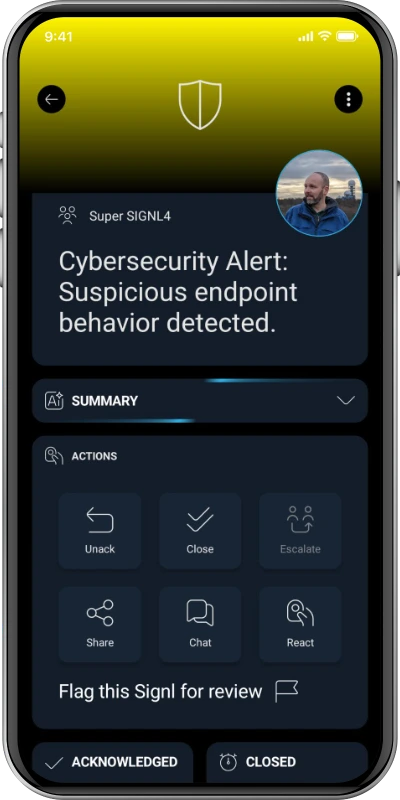

# SIGNL4 Integration with Netskope

[Netskope](https://www.netskope.com/) helps organizations protect users, applications, and data with cloud security capabilities such as data loss prevention (DLP), threat protection, and security policy enforcement. Using **Netskope Cloud Exchange** and its **Ticket Orchestrator Webhook plugin**, selected security alerts can be forwarded to [SIGNL4](https://www.signl4.com/) through an HTTPS request.

SIGNL4 adds reliable mobile alerting via app push, SMS, and voice calls, along with automated escalation, on-call scheduling, and mobile acknowledgement. Critical security incidents can therefore reach the right analyst, even outside business hours.

Typical use cases include:
* Escalating critical DLP incidents, such as suspected unauthorized sharing of sensitive files
* Alerting an on-call SOC analyst about compromised credential detections
* Notifying security responders about high-priority malware or malicious website alerts
* Routing suspicious user activity or anomaly detections to the responsible team
* Ensuring urgent security policy violations receive acknowledgement and follow-up

## Prerequisites

* A [SIGNL4](https://www.signl4.com/) account and a SIGNL4 team or integration secret
* Access to a Netskope tenant that generates the relevant security alerts
* A configured **Netskope Cloud Exchange** environment with its Netskope tenant integration and **Ticket Orchestrator** module enabled
* Permission to configure the Ticket Orchestrator **Webhook** plugin, business rules, and queues
* Outbound HTTPS connectivity from Cloud Exchange to `https://connect.signl4.com`

> **Note:** This guide describes an integration pattern using Netskope's documented Cloud Exchange Webhook plugin and the SIGNL4 webhook. It is not a prebuilt or officially certified Netskope–SIGNL4 connector and has not been verified in a live Netskope tenant. Menu names and options may vary depending on your Cloud Exchange version.

## How to Integrate

Netskope Cloud Exchange can retrieve relevant Netskope alerts, filter them using Ticket Orchestrator business rules, and forward selected events to SIGNL4 via an HTTP POST request.

```text
Netskope security alert (DLP, malware, anomaly, ...)
                         |
                         v
                Netskope Cloud Exchange
                         |
                         v
             Ticket Orchestrator business rule
                         |
                         v
                 Webhook plugin (POST)
                         |
                         v
                       SIGNL4
                         |
                  +------+------+------+
                  |      |      |      |
                 Push   SMS   Voice  Escalation
```

### 1. Get Your SIGNL4 Webhook URL

In SIGNL4, select the target team and locate its team or integration secret. The webhook URL follows this format:

```text
https://connect.signl4.com/webhook/YOUR_SIGNL4_SECRET
```

Replace `YOUR_SIGNL4_SECRET` with your actual secret. Keep this URL confidential because the secret in the URL authorizes incoming alerts.

For details, see the [SIGNL4 Webhook integration](https://docs.signl4.com/integrations/webhook/).

### 2. Configure the Webhook Plugin in Netskope Cloud Exchange

1. Sign in to your Netskope Cloud Exchange environment.
2. Make sure the **Ticket Orchestrator** module and the Netskope tenant plugin are configured.
3. Navigate to **Settings > Plugins** (or the equivalent plugin configuration page for your version).
4. Find and select the **Webhook** plugin for Ticket Orchestrator.
5. Enter a descriptive configuration name, such as `SIGNL4 Security Alerts`.
6. Set an appropriate **Sync Interval**. Netskope's Webhook plugin documentation suggests **5 minutes or more**; evaluate this delay against your response-time requirements.
7. Enter the SIGNL4 webhook URL from step 1.
8. Save the configuration.

The Webhook plugin sends HTTP **POST** requests to the configured URL. The SIGNL4 endpoint does not need an extra authorization header because the team or integration secret is part of the URL.

> **Timing consideration:** Cloud Exchange processes alerts on its configured synchronization schedule. This integration should not be assumed to deliver alerts instantaneously. Test actual end-to-end delivery time before using it for incidents with strict response-time requirements.

### 3. Create a Ticket Orchestrator Business Rule

1. In Cloud Exchange, open **Ticket Orchestrator > Business Rules**.
2. Choose **Create New Rule**.
3. Name the rule, for example `Critical Netskope Alerts to SIGNL4`.
4. Configure filters for the alerts that require immediate human attention. Depending on available fields, you may filter by alert type, severity, or other relevant attributes.
5. Save the rule.
6. If available, use the business rule's **Fetch** or test functionality to check which alerts match.

Netskope documents support for webhook notifications for alert types including **DLP, Malware, Compromised Credentials, Anomaly, Malsite, Policy**, and others.

Avoid sending every informational event to an on-call team. Start with a small set of high-priority detections to limit alert noise.

### 4. Configure a Queue and JSON Payload

1. Navigate to **Ticket Orchestrator > Queues** and choose **Add Queue Configuration**.
2. Select the business rule created in step 3.
3. Select the `SIGNL4 Security Alerts` Webhook plugin configuration and the relevant source queue or configuration, where required.
4. Find the queue's **Map Field** or **custom message** setting.
5. Enter a JSON body that SIGNL4 can interpret. Start with the static example below to verify connectivity before inserting Netskope alert values.
6. Save and enable the queue as appropriate.

Example static JSON payload:

```json
{
  "Title": "Netskope: Critical DLP incident",
  "Message": "Potential unauthorized upload of sensitive data. Please investigate.",
  "Severity": "Critical",
  "Alert Type": "DLP",
  "User": "example.user@example.com",
  "Source": "Netskope",
  "X-S4-ExternalID": "netskope-example-alert-123",
  "X-S4-Status": "new"
}
```

After confirming that a static payload reaches SIGNL4, replace example values with **dynamic Netskope alert attributes** using the mapping syntax supported by your Cloud Exchange version. Netskope's documentation describes accessing alert attributes using `$` in the custom message field; the exact field names depend on the incoming alert and should be confirmed in your tenant.

Recommended mappings:

* **Title:** Short alert summary, including the detection type
* **Message:** Context and the action required from the security analyst
* **Severity:** The actual Netskope severity or priority, if available
* **Alert Type:** DLP, Malware, Anomaly, or another available alert category
* **User / Device:** Affected identity or asset, only where needed for triage
* **X-S4-ExternalID:** A stable, unique alert identifier for correlation
* **X-S4-Status:** `new` when creating an alert

> **Important:** Netskope's documentation notes that unescaped double quotes in dynamically substituted text can make the outgoing JSON invalid. Validate the resulting JSON when mapping descriptions or other free-text attributes. Do not include passwords, access tokens, sensitive file contents, or unnecessary personal information in mobile alert messages.

### 5. Test the Integration

1. Ensure Netskope Cloud Exchange has a qualifying alert, or use an authorized test alert in a non-production environment.
2. Check that the alert appears in **Ticket Orchestrator > Alerts**.
3. Verify that the business rule matches the event and that the configured queue processes it.
4. Inspect **Ticket Orchestrator > Tickets** and **Cloud Exchange > Logging** for delivery information or errors.
5. Verify that a corresponding alert is received in the SIGNL4 mobile app with the expected title, message, and custom fields.
6. Test on-call routing, escalation, and acknowledgement before enabling the integration for critical production alerts.



*Illustrative SIGNL4 mobile security alert screenshot; not an actual Netskope incident.*

### 6. Optional: Correlate Alert Updates

SIGNL4's webhook supports updating alerts through `X-S4-ExternalID` and `X-S4-Status`. If you implement a **separate workflow** that emits updates when a Netskope incident changes status, use the same stable external ID as the original alert.

For example, a subsequent POST to the SIGNL4 webhook can resolve the corresponding SIGNL4 alert:

```json
{
  "X-S4-ExternalID": "netskope-example-alert-123",
  "X-S4-Status": "resolved"
}
```

This is an optional extension, **not a confirmed feature of the basic Netskope Cloud Exchange Webhook plugin configuration in this guide**. The documented notification workflow creates outbound notifications; do not assume it automatically tracks incident resolution or sends status-change messages.

> **One-way by default:** Acknowledging or resolving an alert in SIGNL4 does **not** update the incident in Netskope. A reverse integration would require a separately designed and tested workflow using the relevant APIs.

## Example

A Netskope DLP policy detects an attempted upload of sensitive company data to an unsanctioned cloud service. Netskope Cloud Exchange selects the high-priority event and sends it to SIGNL4 through its Webhook plugin. SIGNL4 then notifies the security analyst currently on call via app push, SMS, or voice call, and escalates if nobody responds.

This is useful for SOC teams, after-hours security operations, and urgent incidents that should not remain unnoticed in a dashboard or email inbox.

## Troubleshooting

* **No alert in SIGNL4:** Verify the SIGNL4 webhook URL and secret, outbound HTTPS access, webhook plugin configuration, and delivery logs.
* **No eligible events:** Check that Netskope alerts are available in Ticket Orchestrator and that the business rule selects the intended alert types.
* **No webhook notifications:** Check the queue configuration, selected plugin, enabled state, sync interval, and Cloud Exchange logs.
* **Incorrect or empty fields:** Review field mapping, available Netskope alert attributes, and generated JSON.
* **Invalid JSON:** Check free-text values containing quotation marks or other characters that require JSON escaping.
* **Delayed alerts:** Inspect the Cloud Exchange polling/synchronization interval and queue processing; measure actual delivery time.
* **Duplicate alerts:** Review repeated events, filters, and unique alert ID mapping. A stable external ID can help correlate SIGNL4 events, but does not substitute for correct deduplication rules.
* **Status updates do not work:** Confirm a separate status-update workflow exists and uses the same `X-S4-ExternalID` as the initial alert.

## References

* [Netskope: Webhook Plugin for Ticket Orchestrator](https://docs.netskope.com/en/webhook-plugin-for-ticket-orchestrator)
* [Netskope: Cloud Exchange](https://www.netskope.com/products/cloud-exchange)
* [Netskope: Ticket Orchestrator Plugin](https://docs.netskope.com/en/ticket-orchestrator-v2-2-0-plugin)
* [SIGNL4 Webhook Integration](https://docs.signl4.com/integrations/webhook/)

That's it. Selected critical Netskope security alerts can now reach the right on-call person through SIGNL4 mobile alerting and automated escalation.
