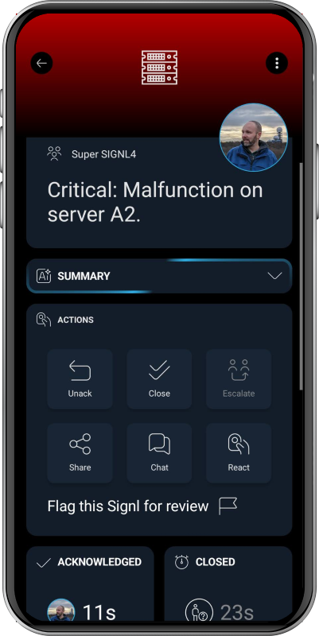

# SIGNL4 Integration with OpenNMS

[OpenNMS](https://www.opennms.com/) is a network monitoring and management platform for discovering infrastructure, tracking service availability, collecting performance data, and detecting events and outages. With the **webhook notification strategy** available in recent OpenNMS Horizon versions, selected notifications can be forwarded directly to [SIGNL4](https://www.signl4.com/) through HTTPS.

SIGNL4 adds reliable mobile alerting via app push, SMS, and voice calls, along with automated escalation, on-call scheduling, and mobile acknowledgement. This helps ensure that critical network and infrastructure problems reach the right engineer, even outside office hours.

Typical use cases include:

* Alerting the on-call network engineer when a critical router or switch becomes unavailable
* Escalating outages of important servers or application services
* Notifying the responsible team about high-priority interface or connectivity failures
* Sending urgent performance threshold violations to mobile responders
* Ensuring after-hours infrastructure incidents receive acknowledgement and follow-up

## Prerequisites

* A [SIGNL4](https://www.signl4.com/) account and a SIGNL4 team or integration secret
* An OpenNMS installation with permission to configure notification commands, destination paths, and event notifications
* **OpenNMS Horizon 36** or another version confirmed to support `org.opennms.netmgt.notifd.WebhookNotificationStrategy` for the direct webhook method below
* Outbound HTTPS access from the OpenNMS server to `https://connect.signl4.com`
* Globally enabled OpenNMS notifications and a relevant monitored event or notification definition

> **Version note:** This guide uses the webhook notification strategy documented for OpenNMS Horizon 36. Older Horizon or Meridian versions may not include this strategy, or may use different configuration options. For those installations, consider an external notification command or the [SIGNL4 email integration](https://docs.signl4.com/integrations/email/), after checking your version-specific OpenNMS documentation. The configuration below is an example based on documented functionality and has not been verified against a live OpenNMS installation.

## How to Integrate

OpenNMS detects a critical event, selects a notification based on its configured rules, and sends a webhook to SIGNL4. SIGNL4 then notifies the team member currently on call and can escalate until someone responds.

```text
OpenNMS event (node down, service outage, threshold, ...)
                         |
                         v
             OpenNMS event notification
                         |
                         v
        Destination path + webhook command
                         |
                         v
              HTTP POST to SIGNL4
                         |
                  +------+------+------+
                  |      |      |      |
                 Push   SMS   Voice  Escalation
```

### 1. Get Your SIGNL4 Webhook URL

In SIGNL4, select the team that should receive OpenNMS alerts and locate its team or integration secret. Your webhook URL has this format:

```text
https://connect.signl4.com/webhook/YOUR_SIGNL4_SECRET
```

Replace `YOUR_SIGNL4_SECRET` with your real secret. Treat this URL as a credential and do not publish it in screenshots, source repositories, or shared logs.

See the [SIGNL4 Webhook integration](https://docs.signl4.com/integrations/webhook/) for details.

### 2. Configure an OpenNMS Webhook Notification Command

On the OpenNMS server, edit:

```text
${OPENNMS_HOME}/etc/notificationCommands.xml
```

Add the following command inside the file's existing root element (do not create a second root element):

```xml
<command binary="false">
  <name>signl4</name>
  <execute>org.opennms.netmgt.notifd.WebhookNotificationStrategy</execute>
  <comment>Send critical OpenNMS notifications to SIGNL4</comment>
  <argument streamed="false">
    <substitution>signl4</substitution>
    <switch>-name</switch>
  </argument>
  <argument streamed="false">
    <switch>-url</switch>
  </argument>
  <argument streamed="false">
    <substitution>{"Title":"${subject}","Message":"${textMessage}","Source":"OpenNMS"}</substitution>
    <switch>-body</switch>
  </argument>
  <argument streamed="false">
    <switch>-subject</switch>
  </argument>
  <argument streamed="false">
    <switch>-tm</switch>
  </argument>
</command>
```

This command uses the OpenNMS webhook strategy to send a JSON payload containing the notification subject and text. OpenNMS performs the `${subject}` and `${textMessage}` substitutions in the webhook body and escapes substituted JSON strings.

For better secret handling, put the SIGNL4 webhook URL in a dedicated OpenNMS system-properties file, for example:

```text
${OPENNMS_HOME}/etc/opennms.properties.d/signl4.properties
```

Add this property, replacing the placeholder:

```properties
org.opennms.netmgt.notifd.webhook.signl4.url=https://connect.signl4.com/webhook/YOUR_SIGNL4_SECRET
```

The `-name` value `signl4` selects the corresponding named webhook system property. Restrict access to the properties file because it contains the team secret. Make sure the new system property is loaded by your OpenNMS installation; a service restart may be required for properties-file changes, depending on your deployment.

> **Alternative:** The webhook URL can also be placed directly in a `<substitution>` for the `-url` argument, but that exposes the secret in `notificationCommands.xml`. OpenNMS recommends system properties as a way to avoid this.

### 3. Configure a Destination Path

In the OpenNMS web interface:

1. Navigate to **Administration > Configure OpenNMS > Configure Notifications > Configure Destination Paths** (labels may vary by version).
2. Create a new path, for example `SIGNL4 Critical Alerts`, or edit an existing destination path.
3. Add an appropriate OpenNMS user or group as the target. This is used by OpenNMS to execute the notification command; SIGNL4 will handle the actual mobile on-call routing.
4. Select the new `signl4` notification command for that target.
5. Save the destination path.

Keep the OpenNMS routing configuration simple where possible. SIGNL4 can manage on-call shifts, mobile notification channels, and repeated escalation without duplicating these processes in OpenNMS.

### 4. Create or Update an Event Notification

1. Make sure notifications are **enabled globally** in OpenNMS.
2. Go to **Administration > Configure OpenNMS > Configure Notifications > Configure Event Notifications**.
3. Create a notification for the event you want to forward, or edit an existing one. Typical examples include `nodeDown`, `nodeLostService`, and important threshold events.
4. If appropriate, configure a filter that limits the notification to business-critical nodes, IP ranges, or services.
5. Select the `SIGNL4 Critical Alerts` destination path.
6. Set a meaningful subject and text message. For example:
   * **Subject:** `OpenNMS: Critical network outage`
   * **Text:** `A monitored network device or service is unavailable. Please investigate in OpenNMS.`
7. Save and enable the event notification.

Start with a small set of critical events. Avoid forwarding all informational events to the on-call team.

### 5. Test the Integration

Before testing an OpenNMS event, you can verify that SIGNL4 accepts requests using this sample:

```bash
curl --request POST \
  --url "https://connect.signl4.com/webhook/YOUR_SIGNL4_SECRET" \
  --header "Content-Type: application/json" \
  --data '{
    "Title": "OpenNMS: Router unreachable",
    "Message": "Core router is unreachable. Please investigate.",
    "Device": "core-router-01",
    "Severity": "Critical",
    "Source": "OpenNMS"
  }'
```

Then test the actual OpenNMS notification workflow:

1. Generate an authorized test event, or use an existing event that matches the notification definition.
2. Confirm the event generates an OpenNMS notification with the intended destination path and command.
3. Check `${OPENNMS_HOME}/logs/daemon/notifd.log` (or your deployment's equivalent log location) if the notification is not delivered.
4. Verify that the SIGNL4 mobile app shows the expected subject and message.
5. Test on-call routing, escalation, and mobile acknowledgement before enabling the integration for production incidents.



*Illustrative SIGNL4 mobile alert screenshot; not an actual OpenNMS incident.*

### 6. Optional: Correlate Recovery Events

The SIGNL4 inbound webhook can correlate updates when the original alert and subsequent update share an `X-S4-ExternalID`. For example, an alert could be created with:

```json
{
  "Title": "OpenNMS: Router unreachable",
  "Message": "Core router is down.",
  "X-S4-ExternalID": "opennms-node-42-outage-123",
  "X-S4-Status": "new"
}
```

A later message can resolve that same SIGNL4 alert:

```json
{
  "X-S4-ExternalID": "opennms-node-42-outage-123",
  "X-S4-Status": "resolved"
}
```

The basic notification command in step 2 **does not implement event correlation**. To support automatic resolution, build a separate mapping that supplies a stable incident-specific ID to both the failure notification and its matching recovery notification. An OpenNMS node ID alone is generally insufficient, because different outages on the same node would share it.

> **One-way by default:** Acknowledging or closing an alert in SIGNL4 does **not** automatically acknowledge or clear the OpenNMS alarm. Reverse status synchronization would require a separate, authenticated integration using SIGNL4 outbound webhooks and the relevant OpenNMS API, with explicit correlation and loop prevention.

## Example

OpenNMS detects that a core network router has become unreachable. An event notification matches the outage and invokes the `signl4` webhook command. SIGNL4 sends the alert to the network engineer currently on call via app push, SMS, or voice call. If nobody responds, SIGNL4 escalates according to the team's configured rules.

This integration is especially useful for network operations centers, distributed infrastructure, and after-hours incidents where an email or dashboard notification may go unnoticed.

## Troubleshooting

* **No notification generated:** Check whether OpenNMS notifications are globally enabled, the event notification is active, and the event matches its filters.
* **Webhook command not available:** Confirm the OpenNMS version supports `WebhookNotificationStrategy`, and check the XML syntax and selected notification command.
* **No alert in SIGNL4:** Verify the webhook URL and team secret, outbound HTTPS connectivity, and the selected destination path.
* **Webhook URL not applied:** Check the named system property, its file location, and whether the updated property has been loaded.
* **Missing or incorrect content:** Verify the notification's subject and text message, and inspect the OpenNMS notification logs.
* **Too many notifications:** Narrow the notification filters to critical nodes, services, or events and review whether OpenNMS and SIGNL4 escalation rules overlap.
* **Repeated alerts:** Review whether multiple event notifications or destination paths match the same incident. Add external ID correlation only after defining an incident-specific ID strategy.
* **Recovery does not resolve the mobile alert:** The example command does not add correlation fields or handle recovery events. Implement and test a matching external ID workflow first.
* **Delivery failures:** Inspect `notifd.log` for HTTP errors, timeouts, proxy problems, or malformed JSON.

## References

* [OpenNMS Horizon: Webhook Notifications](https://docs.opennms.com/horizon/36/operation/deep-dive/notifications/strategies/webhook.html)
* [OpenNMS Horizon: Notification Commands](https://docs.opennms.com/horizon/36/operation/deep-dive/notifications/commands.html)
* [OpenNMS Horizon: Notification Quick Start](https://docs.opennms.com/horizon/36/operation/quick-start/notifications.html)
* [OpenNMS Meridian: Configure Notifications](https://docs.opennms.com/meridian/latest/operation/quick-start/notification-config.html)
* [SIGNL4 Webhook Integration](https://docs.signl4.com/integrations/webhook/)

That's it. Critical OpenNMS network and infrastructure events can now reach the right on-call engineer through SIGNL4 mobile alerting and automated escalation.
