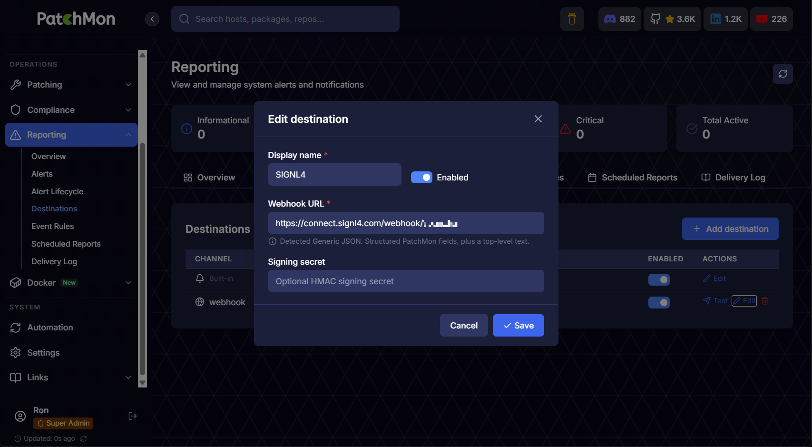
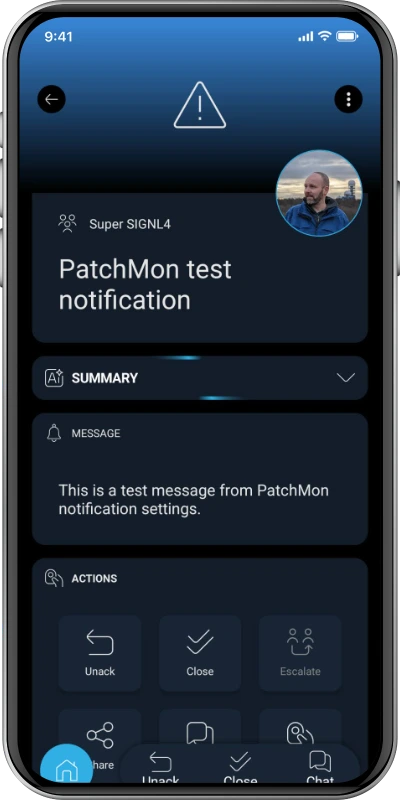

# SIGNL4 Integration with PatchMon

[PatchMon](https://patchmon.net/) is an open-source patch and server management platform for monitoring updates, security exposure, compliance, and host health across your infrastructure. It also provides patch-run tracking and Docker monitoring.

By forwarding selected PatchMon events to [SIGNL4](https://www.signl4.com/) through a webhook, you can notify the responsible on-call engineer via mobile app push, SMS, and voice calls. SIGNL4 adds duty scheduling, acknowledgement, and automated escalation when an urgent issue needs human attention.

Typical use cases include:

* **Failed patch runs:** Alert the on-call administrator when a scheduled patch operation fails and requires investigation.
* **Outstanding security updates:** Escalate when a server exceeds a configured threshold for pending security patches.
* **Host availability:** Notify the operations team when a monitored host stops reporting or goes offline.
* **Compliance issues:** Forward important compliance scan results for timely review and remediation.
* **Docker monitoring:** Alert the responsible engineer when a monitored container stops unexpectedly.

## Prerequisites

* A running [PatchMon](https://github.com/PatchMon/PatchMon) instance, self-hosted or on PatchMon Cloud, with webhook notifications available.
* Permission to manage notification destinations and event rules in PatchMon.
* A [SIGNL4](https://www.signl4.com/) account and a team that should receive the alerts.

## How to Integrate

PatchMon sends matching events to a generic webhook destination. The integration requires both a **webhook destination** and an **event rule** that forwards the desired events to it.

### 1. Get Your SIGNL4 Webhook URL

1. Sign in to [SIGNL4](https://account.signl4.com/) and select the team that should receive PatchMon alerts.
2. Go to **Teams > Integrations > Webhook** and copy the team's webhook URL. Its format is:

   ```text
   https://connect.signl4.com/webhook/YOUR_SIGNL4_SECRET
   ```

Keep this URL private, as it contains the SIGNL4 team or integration secret. See the [SIGNL4 Webhook integration](https://docs.signl4.com/integrations/webhook/) for more information.

### 2. Configure the PatchMon Webhook Destination

1. Sign in to the PatchMon web portal.
2. Go to **Reporting > Destinations** and click **Add destination**.
3. Select **Webhook** and click **Next**.
4. Enter a display name, such as `SIGNL4`, and paste the SIGNL4 webhook URL into **Webhook URL**.
5. Leave the destination **Enabled** and click **Create**.



*PatchMon webhook destination configured to send notifications to SIGNL4.*

### 3. Route PatchMon Events to SIGNL4

1. Go to **Reporting > Event Rules** and click **Add event rule**.
2. Select the `SIGNL4` webhook destination.
3. Choose the events that require a mobile response, for example failed patch runs, host-down events, exceeded security-update thresholds, or stopped containers.
4. Optionally limit the rule by **minimum severity**, **host group**, or **specific hosts** to avoid unnecessary alerts.
5. Keep the rule enabled and save it.

For example, route failed patch runs and critical security-update threshold events to SIGNL4, while keeping routine patch-completion messages in PatchMon. The event types and available filters depend on your PatchMon configuration.

### 4. Test the Integration

1. In **Reporting > Destinations**, find the `SIGNL4` destination and use its **Test** action.
2. Check that the test notification arrives in the SIGNL4 mobile app.
3. Trigger or wait for a matching PatchMon event to verify that the event rule forwards actual alerts.
4. If an event does not arrive, check **Reporting > Delivery Log** for its delivery status and errors, and verify the event rule and destination are enabled.

An alert in SIGNL4 might look like this:



*Example mobile alert in SIGNL4.*

Once configured, SIGNL4 can route important PatchMon events to the available on-call team and escalate them if nobody responds.

## References

* [PatchMon](https://patchmon.net/)
* [PatchMon GitHub Repository](https://github.com/PatchMon/PatchMon)
* [PatchMon Notification Destinations](https://patchmon.net/docs/patchmon-admin-guide/notification-destinations)
* [PatchMon Notification Routes and Delivery Log](https://patchmon.net/docs/patchmon-admin-guide/notification-routes-and-delivery-log)
* [SIGNL4 Webhook Integration](https://docs.signl4.com/integrations/webhook/)
