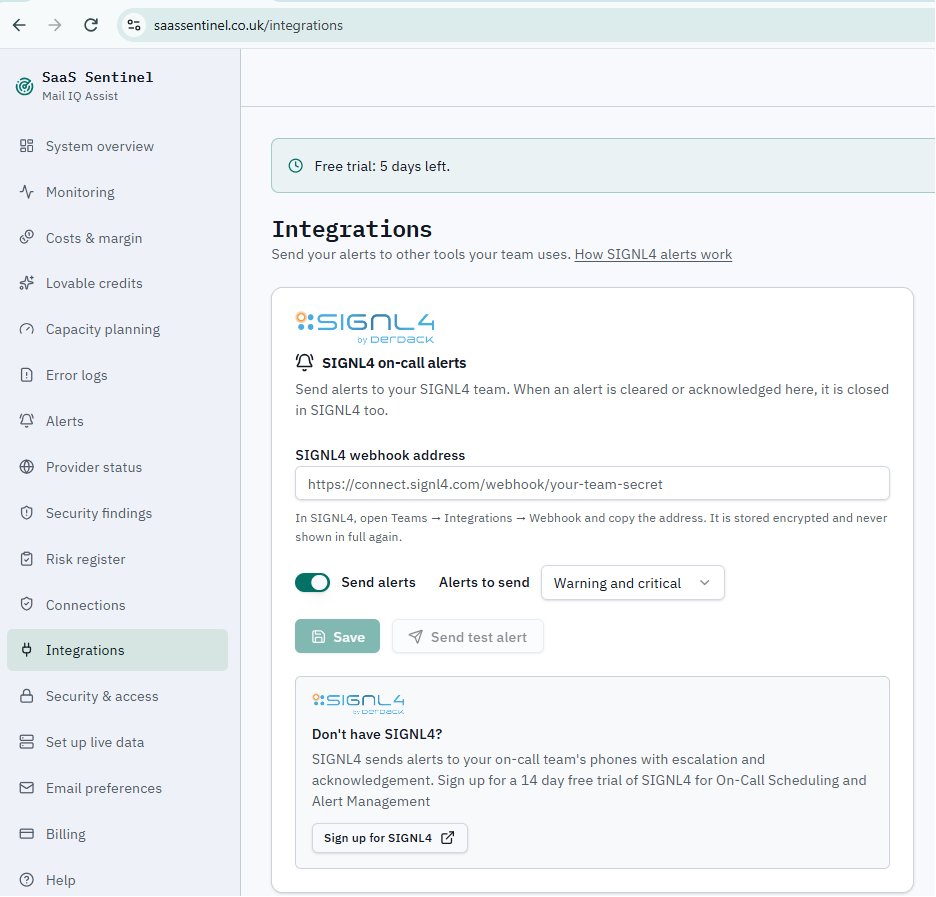
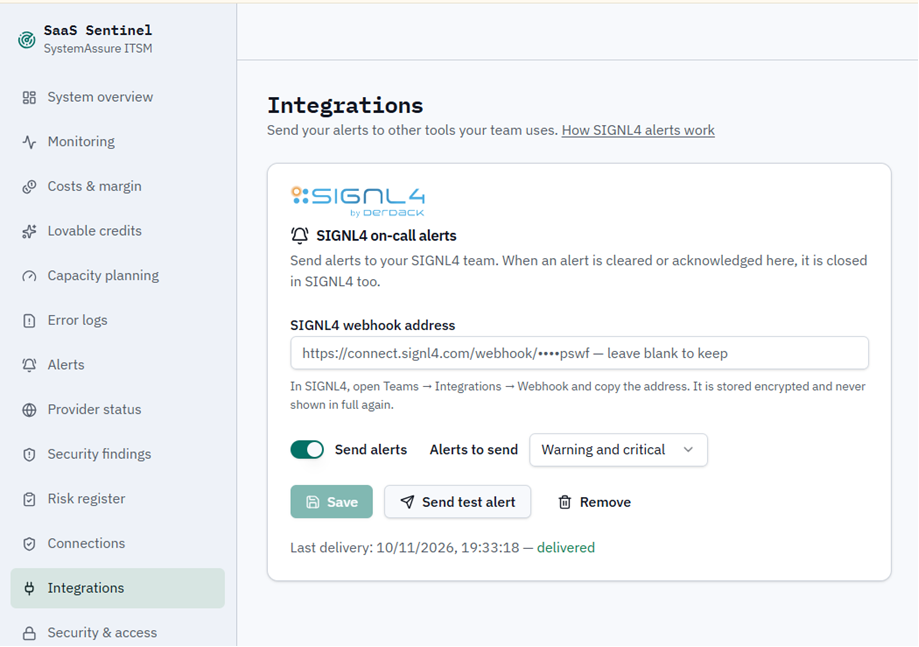
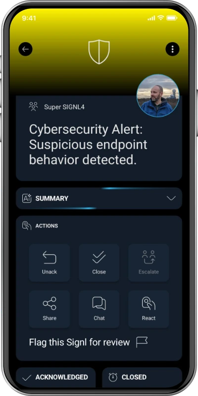

# SIGNL4 Integration with SaaS Sentinel

[SaaS Sentinel](https://saassentinel.co.uk/) is a SaaS portfolio intelligence platform for monitoring application availability, performance, security, capacity, and costs. It helps teams manage multiple SaaS applications, including projects built with Lovable and Supabase, from one place.

With its **built-in SIGNL4 integration**, SaaS Sentinel can send important monitoring alerts directly to [SIGNL4](https://www.signl4.com/). SIGNL4 notifies the responsible on-call team through mobile app push notifications, SMS, and voice calls, with automated escalation, duty scheduling, and mobile acknowledgement. When an alert is acknowledged or cleared in SaaS Sentinel, the corresponding alert is automatically closed in SIGNL4.

Typical use cases include:

* Notify on-call engineers when a SaaS application or website becomes unavailable.
* Escalate critical Supabase database health or performance alerts.
* Alert the responsible team about application errors or provider-related issues.
* Route urgent monitoring events to the right person outside business hours.
* Automatically close mobile alerts when the underlying issue is acknowledged or resolved in SaaS Sentinel.

## Prerequisites

* A [SaaS Sentinel](https://saassentinel.co.uk/) account with access to the **Integrations** settings.
* A [SIGNL4](https://www.signl4.com/) account and team to receive notifications. If you do not have an account, SaaS Sentinel offers a SIGNL4 trial sign-up link directly on its integration page.
* The SIGNL4 team's webhook URL.

## How to Integrate

SaaS Sentinel provides a native SIGNL4 configuration page. No custom script or separately configured HTTP workflow is required.

```text
SaaS Sentinel monitoring alert
              |
              v
     SIGNL4 integration
      (severity filter)
              |
              v
            SIGNL4
              |
      +-------+-------+
      |       |       |
     Push    SMS    Voice
              |
              v
  On-call routing / escalation
              |
              v
       Mobile response

SaaS Sentinel acknowledgment or alert clearance
              |
              v
     Close alert in SIGNL4
```

### 1. Get Your SIGNL4 Webhook URL

1. Sign in to [SIGNL4](https://account.signl4.com/) and open the team that should receive SaaS Sentinel alerts.
2. Navigate to **Teams > Integrations > Webhook**.
3. Copy the team's webhook address. It follows this format:

   ```text
   https://connect.signl4.com/webhook/YOUR_SIGNL4_SECRET
   ```

4. Keep this URL private because it contains a team or integration secret.

For more information, see the [SIGNL4 Webhook integration](https://docs.signl4.com/integrations/webhook/).

### 2. Configure SIGNL4 in SaaS Sentinel

1. Sign in to [SaaS Sentinel](https://saassentinel.co.uk/).
2. Select **Integrations** from the left navigation menu.
3. Find the **SIGNL4 on-call alerts** section.
4. Paste the copied URL into **SIGNL4 webhook address**.
5. Enable **Send alerts**.
6. Under **Alerts to send**, select the appropriate alert severity level, such as **Warning and critical**.
7. Click **Save**.

SaaS Sentinel stores the webhook address encrypted. Once saved, the existing secret is masked in the interface rather than displayed in full.

> **Tip:** If no SIGNL4 webhook has been configured, the integration page shows a **Sign up for SIGNL4** option. Once a webhook is added, this sign-up option disappears and **Send test alert** becomes available.



*SIGNL4 integration settings before adding the webhook, including the trial sign-up option.*

### 3. Send a Test Alert

1. After saving the webhook URL, click **Send test alert** in the SaaS Sentinel integration page.
2. Check that an alert arrives in the SIGNL4 mobile app for the configured team.
3. Confirm that the expected on-call user receives the notification.
4. Review the delivery status shown on the SaaS Sentinel integration page. For successful delivery, it displays a **delivered** status and the last delivery timestamp.
5. If needed, adjust the severity selection or SIGNL4 on-call settings.



*Configured SIGNL4 integration with the enabled test-alert button and a successful delivery status.*

The alert in SIGNL4 might look like this.



### 4. Automatic Alert Closure

The integration also supports automatic closure of matching alerts in SIGNL4. When a SaaS Sentinel alert is **acknowledged or cleared in SaaS Sentinel**, SaaS Sentinel closes the corresponding SIGNL4 alert as well.

This helps prevent on-call responders from continuing to receive notifications for an issue that has already been handled or has recovered.

> **Note:** This describes status updates from **SaaS Sentinel to SIGNL4**. It does not imply that acknowledging an alert in the SIGNL4 app also acknowledges it in SaaS Sentinel.

### 5. Manage or Remove the Integration

You can return to **Integrations > SIGNL4 on-call alerts** in SaaS Sentinel to change the alert severity selection, enable or disable **Send alerts**, replace the webhook address, send another test alert, or use **Remove** to disconnect the configured webhook.

## Example

A SaaS application becomes unreachable during the night. SaaS Sentinel detects the availability issue and creates a critical alert. Through the built-in SIGNL4 integration, the alert is forwarded to the on-call team.

SIGNL4 sends a push notification to the engineer currently on duty and can escalate using SMS or voice calls according to the team's alerting configuration. The engineer investigates the problem without needing to constantly watch a dashboard.

When the application recovers and SaaS Sentinel clears the alert, the related SIGNL4 alert is automatically closed.

## Troubleshooting

* **No alerts arrive in SIGNL4:** Verify that the webhook URL has been saved correctly, **Send alerts** is enabled, and the selected severity level includes the triggering alert.
* **Send test alert is disabled:** Save a valid SIGNL4 webhook address first. The test option is available after a webhook is configured.
* **Test delivery fails:** Check the webhook URL and team secret, then review any delivery information available in SaaS Sentinel.
* **No notification on the expected phone:** Check the SIGNL4 team's membership, duty schedule, notification settings, and escalation configuration.
* **An alert is not closed automatically:** Check whether the original SaaS Sentinel alert has actually been acknowledged or cleared. If the issue persists, inspect the integration's delivery status and contact SaaS Sentinel support.
* **Need to change the webhook secret:** Update the URL in the SaaS Sentinel integration settings and save it again.

## References

* [SaaS Sentinel](https://saassentinel.co.uk/)
* [SaaS Sentinel Features](https://saassentinel.co.uk/features)
* [SIGNL4 Webhook Integration](https://docs.signl4.com/integrations/webhook/)
* [SIGNL4](https://www.signl4.com/)

That's it. Important SaaS Sentinel monitoring alerts can now reach the right on-call person through SIGNL4, with reliable mobile notifications, escalation, and automatic closure when alerts are handled in SaaS Sentinel.
