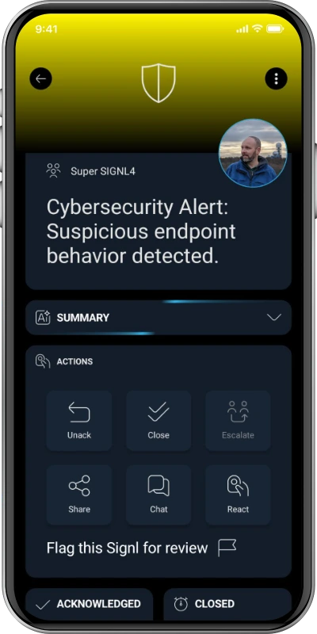

# SIGNL4 Integration with SentinelOne

[SentinelOne Singularity](https://www.sentinelone.com/) helps security teams prevent, detect, investigate, and respond to threats across endpoints and other environments. With the **Singularity XDR Webhook** integration available through the SentinelOne Singularity Marketplace, you can send selected security threat events to [SIGNL4](https://www.signl4.com/) over HTTPS.

SIGNL4 adds reliable mobile app push notifications, SMS, voice calls, automated escalation, on-call scheduling, and mobile acknowledgement. This helps critical endpoint threats reach the responsible security analyst, including outside business hours.

Typical use cases include:
* Escalating high-priority endpoint threats to the on-call SOC analyst
* Notifying the incident response team about suspected ransomware or malicious execution
* Alerting on threats detected on sensitive servers or critical workstations
* Escalating incidents requiring human review after an endpoint security detection
* Routing critical security alerts to the appropriate team outside office hours

## Prerequisites

* A [SIGNL4](https://www.signl4.com/) account, team, and corresponding team or integration secret
* Access to the **SentinelOne Singularity Management Console** and **Singularity Marketplace**
* Permission to install and configure the **Singularity XDR Webhook** (sometimes labeled **Singularity Webhook**) integration
* A SentinelOne subscription and configuration that supports the required webhook trigger options
* A suitable threat event or permitted test scenario

> **Note:** Available Marketplace options, trigger types, and menus depend on the SentinelOne environment, version, license, and permissions. This guide documents a general webhook integration pattern, not a prebuilt or officially certified SentinelOne–SIGNL4 connector. The complete configuration has not been validated against a live SentinelOne tenant.

## How to Integrate

SentinelOne can invoke a webhook when selected threat events occur. The webhook sends an HTTP POST to SIGNL4, which routes the resulting alert to the appropriate on-call personnel.

```text
SentinelOne Singularity threat detection
                  |
                  v
       Singularity XDR Webhook
                  |
                  v
             HTTPS POST
                  |
                  v
                SIGNL4
                  |
           +------+------+------+
           |      |      |      |
          Push   SMS   Voice  Escalation
```

### 1. Get Your SIGNL4 Webhook URL

In SIGNL4, select the target team and locate its team or integration secret. The webhook endpoint has this format:

```text
https://connect.signl4.com/webhook/YOUR_SIGNL4_SECRET
```

Replace `YOUR_SIGNL4_SECRET` with your actual secret. Treat this URL as a credential and keep it out of public source code, shared screenshots, and logs.

See the [SIGNL4 Webhook integration](https://docs.signl4.com/integrations/webhook/) for details.

### 2. Configure the SentinelOne Webhook

1. Sign in to the **SentinelOne Singularity Management Console**.
2. Open **Singularity Marketplace**.
3. Search for **Singularity XDR Webhook** or **Singularity Webhook**, then select **Configure** or **Install** to create a configuration.
4. Give the configuration a descriptive name, such as `SIGNL4 - Critical Threat Alerts`.
5. Under the response-action or trigger options, select the **automated trigger** appropriate for the threat events you want to send. If a manual response-action option is also displayed, it is optional and is **not** a substitute for enabling an automated trigger.
6. Enter the SIGNL4 webhook URL from Step 1.
7. Set the HTTP method/action to **POST**.
8. Select **Custom Body** if available, so that the payload can be mapped to readable SIGNL4 fields. Configure the content type as `application/json`.
9. Choose the appropriate account/site access scope and install or save the webhook configuration.

> **Important:** The exact automated triggers and filtering capabilities depend on the installed SentinelOne webhook integration. If you cannot select an automatic threat trigger, verify the available Marketplace app and permissions. A manual-only response action does not automatically send new detections to SIGNL4.

### 3. Configure the Request Body

For an initial end-to-end test, use the following **static JSON** in the custom request body, if the webhook editor accepts a custom JSON body:

```json
{
  "Title": "SentinelOne: Critical endpoint threat",
  "Message": "Suspicious endpoint activity detected. Please investigate.",
  "Severity": "Critical",
  "Hostname": "workstation-42",
  "Threat ID": "example-threat-123",
  "Source": "SentinelOne Singularity",
  "X-S4-ExternalID": "example-threat-123",
  "X-S4-Status": "new"
}
```

This is an **illustrative SIGNL4 payload**, not a sample of SentinelOne's native threat-event schema. After testing, replace static values with the dynamic fields offered by your SentinelOne webhook configuration.

For example, some SentinelOne XDR Webhook integrations document expressions such as `${activity.threatInfo.threatName}`, `${activity.threatInfo.threatId}`, and `${activity.agentRealtimeInfo.agentComputerName}`. The following is a **template only**; confirm that these variables resolve in your selected trigger before using it:

```json
{
  "Title": "SentinelOne: ${activity.threatInfo.threatName}",
  "Message": "Endpoint security threat requires investigation.",
  "Hostname": "${activity.agentRealtimeInfo.agentComputerName}",
  "Threat ID": "${activity.threatInfo.threatId}",
  "Source": "SentinelOne Singularity",
  "X-S4-ExternalID": "${activity.threatInfo.threatId}",
  "X-S4-Status": "new"
}
```

If your tenant does not support these expressions, use the field picker or documented variables in the webhook editor. Alternatively, select **Full Threat Details** and test the actual payload delivered to SIGNL4 before deciding whether an intermediary is needed for field mapping.

Recommended mapping:

* **Title:** A concise threat name or summary
* **Message:** A short indication of what happened and what action is required
* **Hostname:** The affected endpoint or device
* **Threat ID:** The stable SentinelOne threat identifier
* **Severity:** The event's severity or priority, if supported by your selected trigger
* **X-S4-ExternalID:** The same stable, unique threat identifier for correlation

The SIGNL4 webhook URL already contains the team or integration secret; a separate SIGNL4 authorization header is not normally required. Do not send endpoint telemetry, access tokens, credentials, or sensitive forensic data unless necessary and approved.

### 4. Test the Integration

1. First verify the SIGNL4 webhook independently with a test POST (substitute your own secret):

   ```bash
   curl -X POST "https://connect.signl4.com/webhook/YOUR_SIGNL4_SECRET" \
     -H "Content-Type: application/json" \
     -d '{"Title":"SentinelOne: Test security alert","Message":"Webhook connectivity test","Source":"SentinelOne Singularity"}'
   ```

2. Confirm that the alert appears in the SIGNL4 mobile app and reaches the right team.
3. Use a SentinelOne webhook test option, if available, or generate an authorized test event that matches the configured automated trigger.
4. Check the webhook execution/delivery logs and confirm that dynamic values are replaced with actual event data.
5. Adjust trigger scope and severity filtering to avoid sending low-priority security noise to the on-call team.
6. Verify SIGNL4 acknowledgement and escalation behavior.



*Illustrative SIGNL4 mobile cybersecurity alert; not an actual SentinelOne incident.*

### 5. Optional: Correlate and Resolve Alerts

SIGNL4 can correlate subsequent webhook requests with an existing alert using `X-S4-ExternalID`. If your SentinelOne environment provides a suitable status-change trigger or you have an intermediary that detects threat resolution, you may send a follow-up POST with the **same external ID**:

```json
{
  "X-S4-ExternalID": "example-threat-123",
  "X-S4-Status": "resolved"
}
```

To acknowledge an existing SIGNL4 alert, you may use `"X-S4-Status": "acknowledged"` where appropriate. Test the correlation behavior for your use case before enabling automated status updates.

> Resolving or acknowledging an alert in SIGNL4 does **not** change the SentinelOne threat status. Sending SIGNL4 updates back to SentinelOne requires a separately implemented reverse integration using the relevant APIs. Automatic resolution from SentinelOne is **not** assumed to be available from the standard webhook configuration.

## Example

SentinelOne detects suspicious execution on an important workstation. A configured Singularity XDR Webhook sends the selected threat details to SIGNL4. SIGNL4 immediately notifies the on-call SOC analyst by app push, SMS, or voice call, with escalation if no one responds. The analyst acknowledges the alert in the SIGNL4 app and investigates the threat in SentinelOne.

This is particularly useful for small SOC teams, critical after-hours detections, and events that should not remain unnoticed in a security dashboard.

## Troubleshooting

* **No SIGNL4 alert:** Verify the SIGNL4 secret, HTTPS endpoint, outbound connectivity, JSON format, and webhook delivery status.
* **Webhook not triggered:** Check that an **automated** trigger is enabled, that it matches the threat type, and that the integration is installed at the correct account/site scope.
* **Missing or literal `${...}` values:** Confirm that the selected trigger exposes the variables used in the custom body; inspect a real event or use the editor's available field references.
* **Unexpected or noisy alerts:** Restrict triggers to relevant threats or filter alerts in a supported workflow/intermediary.
* **Duplicate alerts:** Check for repeated threat events and use a stable unique ID in `X-S4-ExternalID`.
* **Alert not resolved:** Confirm that the original alert and subsequent update carry the exact same external ID and that a separate resolution event is actually being sent.
* **Webhook option unavailable:** Verify Singularity Marketplace access, tenant licensing, and integration permissions.

## References

* [SentinelOne](https://www.sentinelone.com/)
* [SentinelOne XDR Webhook setup example – Torq](https://kb.torq.io/en/articles/9140001-sentinelone)
* [SentinelOne webhook configuration example – Binalyze](https://kb.binalyze.ai/air/integrations/webhooks/sentinelone-integration)
* [SentinelOne webhook variable examples – Prelude](https://support.preludesecurity.com/docs/sentinel-one)
* [SIGNL4 Webhook Integration](https://docs.signl4.com/integrations/webhook/)

That's it. Critical SentinelOne detections can now trigger reliable mobile alerting in SIGNL4, with on-call routing and automated escalation until someone responds.
