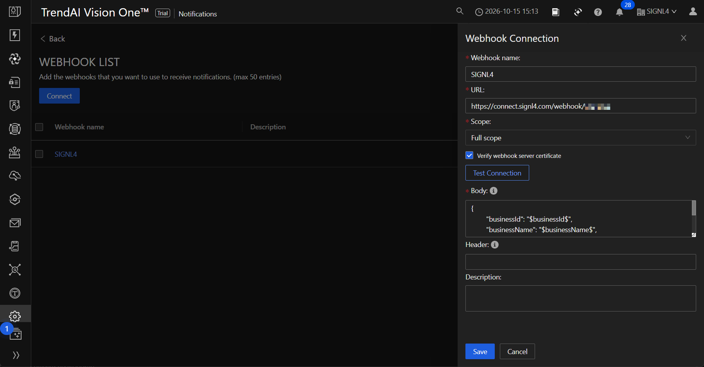
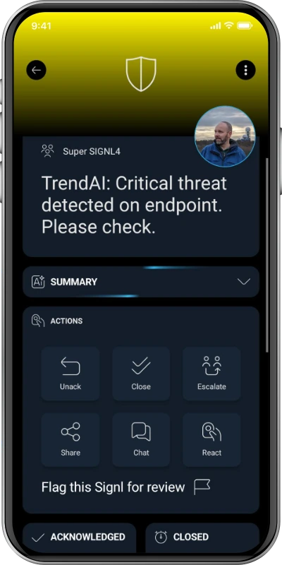

# SIGNL4 Integration with TrendAI Vision One

[TrendAI Vision One](https://www.trendmicro.com/) is a cybersecurity platform that brings security detections, alerts, and response workflows together. Its configurable outbound webhooks can forward selected notifications to third-party services.

SIGNL4 extends security notifications with reliable mobile alerting via app push, SMS, and voice calls, automated escalation, on-call scheduling, acknowledgements, and mobile incident collaboration. This can help security operations teams reach the responsible responder even outside business hours.

Typical use cases include:

* urgent endpoint security detections that require human investigation
* critical security incidents outside office hours
* escalation of suspicious activity to the on-call SOC analyst
* notification of endpoint protection or security system problems
* coordination of incident response across distributed teams

## Prerequisites

* A [SIGNL4](https://www.signl4.com/) account and team with an incoming webhook integration
* A TrendAI Vision One tenant with permission to manage notifications and webhook connections
* At least one suitable TrendAI Vision One notification type enabled for webhook delivery

## How to Integrate

TrendAI Vision One allows you to create a webhook connection and then select it as a notification channel for supported alerts. You can configure the JSON request body, including TrendAI's required `$payload$` placeholder.

### 1. Create the SIGNL4 Webhook

In SIGNL4, create or use an existing incoming webhook integration. Its URL follows this format:

```text
https://connect.signl4.com/webhook/YOUR_SIGNL4_SECRET
```

Replace `YOUR_SIGNL4_SECRET` with your SIGNL4 team or integration secret. Treat this URL as a secret because possession of the URL permits sending alerts to the team.

### 2. Create a Webhook Connection in TrendAI Vision One

1. Sign in to the TrendAI Vision One console.
2. Navigate to **Administration → Notifications → Settings → Webhook List**.
3. Select **Connect** to add a webhook.
4. Enter a name such as `SIGNL4 Security Alerts`.
5. Paste the SIGNL4 webhook URL into the **URL** field.
6. Keep **Verify webhook server certificate** enabled.
7. For a custom webhook, configure the JSON body shown below.
8. Save the connection.

The exact navigation and available notification types can vary by TrendAI Vision One edition or interface version.



### 3. Configure the JSON Body

TrendAI Vision One requires that a custom webhook JSON body include at least one value containing the `$payload$` placeholder. A suggested request body is:

```json
{
  "Subject": "TrendAI Security Notification",
  "Message": "$payload$",
  "Source": "TrendAI Vision One",
  "Category": "Security",
  "X-S4-SourceSystem": "TrendAI"
}
```

The request is sent to SIGNL4 with HTTP POST. The connection URL supplies the destination; no separate SIGNL4 authentication header is normally required.

The `$payload$` placeholder is expanded by TrendAI Vision One into the event information. Its structure and rendering can vary by notification type. Start with the basic payload above and inspect the received alert before adding more field mappings or automated workflows.

**Important:** This payload is a proposed mapping based on the documented webhook configuration, not a live-tested SIGNL4/TrendAI integration. In particular, verify how TrendAI serializes `$payload$` in a JSON string in your tenant. If direct delivery fails because of JSON formatting or transformation needs, use an HTTPS relay (for example, Azure Logic Apps or n8n) to parse the event and post a normalized JSON body to SIGNL4.

### 4. Select Which Security Notifications Use SIGNL4

1. Return to **Administration → Notifications**.
2. Open the relevant alert notification configuration, such as **Endpoint security alerts**, if available in your tenant.
3. Open its **Webhook** delivery tab.
4. Select the newly created **SIGNL4 Security Alerts** webhook connection (or a group containing it).
5. Save the notification settings.

Route high-priority events to SIGNL4 to keep responders focused. You can use SIGNL4 teams and on-call schedules to control who receives them.

### 5. Test the Integration

Use **Test Connection** when configuring the webhook. Then generate an authorized test event of a supported notification type or use a safe test in your environment to confirm that an actual event reaches SIGNL4.

Verify that:

* TrendAI Vision One can reach the HTTPS destination
* a new alert appears in the intended SIGNL4 team
* the event details are readable in the SIGNL4 mobile app
* on-call routing, acknowledgement, and escalation work as expected

**Note:** A successful TrendAI **Test Connection** only verifies the webhook connectivity test; it does not necessarily confirm that a full security notification is correctly transformed and routed.

## Example Workflow

A critical endpoint security detection triggers an outbound notification:

```text
TrendAI Vision One security detection
              |
              v
Configured security notification
              |
              v
HTTPS webhook POST
              |
              v
SIGNL4
   |        |          |
   v        v          v
Mobile    SMS       Voice call
push                (as configured)
              |
              v
On-call acknowledgement / escalation
```

The resulting alert in SIGNL4 might look like this:



This is a generic SIGNL4 alert screenshot for illustration, not a screenshot of a verified TrendAI event.

## Optional: Advanced Alert Processing

For more complex deployments, place a workflow service (for example, Azure Logic Apps, n8n or a custom HTTPS endpoint) between TrendAI Vision One and SIGNL4. This can map source fields to the SIGNL4 payload, create consistent alert subjects, filter severity levels, or correlate alert IDs.

Automatic close or two-way incident status updates are **not** implied by this webhook setup. They require additional processing and appropriate TrendAI/API capabilities, which should be evaluated separately.

## References

* [TrendAI Vision One – Managing webhooks](https://docs.trendmicro.com/en-us/documentation/article/trend-vision-one-managing-webhooks)
* [TrendAI Vision One – Configuring endpoint security alerts](https://docs.trendmicro.com/en-us/documentation/article/trend-vision-one-configure-endpoint-alerts)
* [SIGNL4 Incoming Webhook](https://docs.signl4.com/integrations/webhook/)

That's it. TrendAI Vision One security notifications can now be routed into SIGNL4 for mobile response and on-call escalation, subject to verification of the webhook payload in your environment.
